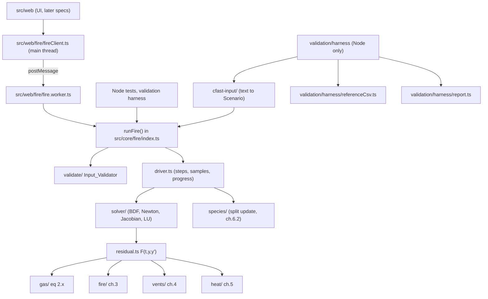
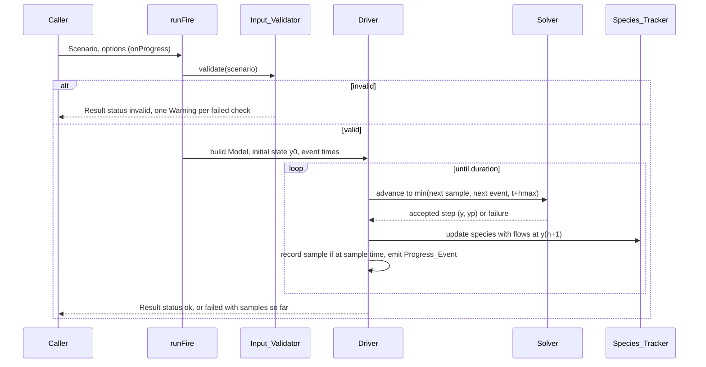
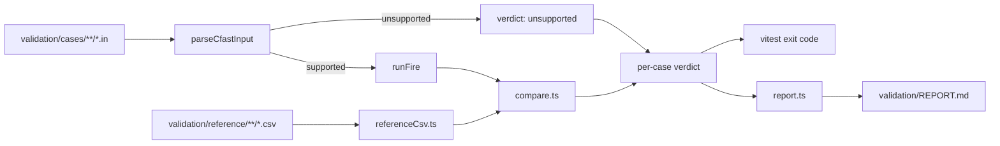

# Design Document

## Overview

The fire-zone feature is a TypeScript re-implementation of the core of the NIST CFAST 7.7.7 two-zone compartment fire model. It lives in `src/core/fire/` as pure functions, with no DOM, no globals and no `Math.random`. It runs unchanged in Node 24 and in a Web Worker. Input is a `Scenario` object. Output is a `Result` with a time series per compartment and per vent, a list of `Warning`s and a status of `ok`, `invalid` or `failed`.

The design covers all 15 requirements:

| Requirement | Where in this design |
|---|---|
| 1, 2 (input, geometry) | Input_Validator, Data Models, Scenario types |
| 3 (gas state equations) | Gas state module, equation map section 3 |
| 4, 5 (vents, shafts) | Vent modules, equation map sections 4 and 5 |
| 6 (fires, oxygen limit, plume) | Fire modules, equation map section 6 |
| 7 (heat transfer) | Heat modules, conduction and radiation simplifications |
| 8 (species, visibility) | Species_Tracker, operator-split species update |
| 9 (solver) | Solver design (BDF1/BDF2, Newton, FD Jacobian, events) |
| 10, 11 (output, progress, determinism, performance) | Driver, Worker_Wrapper, performance strategy |
| 12, 13 (references, validation) | Reference_Script, Validation harness, Report_Generator |
| 14 (properties) | Correctness Properties, Testing Strategy |
| 15 (CFAST readers) | `cfast-input/` reader and reference CSV reader |

### Research findings

The Tech Ref was read from `docs/refs/CFAST_Tech_Ref.pdf` in this session with `pdftotext -layout`. Equation numbers below are the numbers printed in that PDF. Eq. 3.15 was also checked against a rendered image of the page (PDF page 31, printed page 13), because the text extraction lost the bracket placement. No passages are copied into this document.

Findings that shape the design:

1. **The ODE system.** Eq. 2.5 to 2.8 give `dP/dt`, `dVu/dt`, `dTu/dt`, `dTl/dt` per compartment. Eq. 2.9 is an algebraic equation per wall surface (heat flux equals conduction flux). Eq. 2.1 gives `cp = 1012 J/(kg·K)`, `γ = 1.4`, `R = (γ−1)/γ·cp ≈ 289.14 J/(kg·K)`. Appendix B derives these (B.7, B.13, B.19, B.20).
2. **The Tech Ref solves with DASSL.** Appendix C writes the system as `F(t, y, y') = 0` (C.1, C.2) with a solution vector of pressures, upper layer temperatures, upper layer volumes, lower layer temperatures and wall surface temperatures (C.3). Requirement 9.1 says we do not port DASSL. We keep the same residual form and the same gradient-matching coupling (Tech Ref 5.4), and integrate with our own BDF1/BDF2.
3. **Wall construction.** Chapter 5 says each surface can have up to three layers and that all walls of a compartment are the same. The radiation model has four surfaces per compartment: ceiling, upper wall, lower wall, floor (5.1). CFAST 7.7.7 assigns the one wall material list to both the upper-wall and the lower-wall surface (CFAST 7.7.7 source, input_namelist.f90, read_comp). Requirement 2.3 now says the same: one construction for the ceiling, one for the floor, one shared by all four walls. Resolved (Open Item 1).
4. **Leakage.** Section 4.4 describes leakage between a compartment and the outdoors only. CFAST 7.7.7 builds leakage vents to the outside only (CFAST 7.7.7 source, initialization.f90, initialize_leakage). Requirement 4.7 now says the same. Resolved (Open Item 7).
5. **No visibility distance formula.** Section 6.2 gives optical density per metre only (Eq. 6.3, specific extinction coefficient 8700 m²/kg). The design adds the visibility relation `S = 3 / K` for light-reflecting signs, with `K` the extinction coefficient, from the FDS User's Guide (default VIS_C0 = 3, based on Jin's work). The user chose this value. Visibility is not part of the validation gate. Resolved (Open Item 3).
6. **Gas absorptance.** Section 5.1.4 gives the transmittance form (Eq. 5.19, 5.20) but takes the H₂O and CO₂ absorptance from an outside reference. CFAST 7.7.7 supplies the data: two emissivity tables from the SFPE Handbook graphs, a soot absorption constant and a soot density (CFAST 7.7.7 source, radiation.f90, absorb). The design uses them (Open Item 2).
7. **Numerics are not specified.** Appendix C gives no tolerances, step limits or Newton limits. They are our choices, kept in `constants.ts` and labelled as numerical parameters, not physics (accepted by the user, Open Item 10).
8. **CFAST 7.7.7 source as the tie-breaker.** The validation gate compares the model with CFAST 7.7.7, so where the Tech Ref is silent or differs from the code, the design follows what CFAST 7.7.7 does. The Fortran source in `docs/refs/cfast-src/` is a reading reference only (git-ignored). The design describes equations, tables and conventions in its own words and cites them as "CFAST 7.7.7 source, <file>.f90, <routine>". No code is copied. The section "Where CFAST 7.7.7 differs from, or goes beyond, the Tech Ref" lists every such case. The CFAST 7.7.7 User's Guide (`docs/refs/cfast-users-guide/*.tex`) and the Validation Guide (`docs/refs/CFAST_Validation_Guide.pdf`) were read for keywords, units and published values.

The Open Items section at the end records which of these are resolved by the user's decisions or by the CFAST sources, and which stay open.

### Case set

`validation/cases/` holds **21** `.in` files: 2 Energy_Balance, 4 Mass_Balance, 1 Ventilation, 9 Steckler and 5 DelCo (Test_02 to Test_06). `validation/reference/` holds 21 case pairs (42 CSV files). This matches Requirement 12.4. DelCo Test_22 to Test_25 (variable cross-section) were removed by the user, so no case uses `CROSS_SECT_AREAS` and the design has no `unsupported` verdict for the shipped cases. The verdict stays in the harness for CFAST input files that a user adds later (mechanical vents, unknown keywords, Requirement 15.3). Test_02 to Test_06 are multi-storey and use ceiling vents (Requirement 12.6).

## Architecture

### Layering



Dependency rules:

- `src/core/fire/` imports nothing from `src/web/`, `node:*` or the DOM. File and network access happens only in `validation/harness/` and `tools/`.
- Physics modules (`gas/`, `fire/`, `vents/`, `heat/`, `species/`) are pure functions on typed arrays and plain objects. They know nothing about the solver.
- The solver knows nothing about physics. It receives a residual callback `(t, y, yp, out) => void`.
- `residual.ts` is the only place that assembles physics into `F(t, y, y')`.

### Run lifecycle



`runFire` never throws for a Scenario-shaped input. It throws a `TypeError` only when the argument is not an object (Requirement 1.11). Everything else becomes `status: "invalid"` or `status: "failed"` with a Warning (Requirement 11.6).

### Key design decisions

| Decision | Rationale |
|---|---|
| Residual form `F(t, y, y') = 0` with surface temperatures in `y` | Matches Appendix C (C.1 to C.3) and Tech Ref 5.4. Gives the same coupling of gas and wall without a separate heat-flux iteration. |
| Conduction profiles are **not** in `y`. Each residual evaluation solves the tridiagonal system of every wall from the trial surface temperature. | Tech Ref 5.4 describes exactly this: profiles at `t` and `t+Δt` are stored outside the solver vector, and only the surface temperature is unknown. Keeps `y` at 8 values per compartment (240 for 30 compartments). |
| Species are advanced after each accepted step (operator split), not inside `y` | Putting about 14 species masses per compartment into `y` would give about 660 unknowns and a dense LU about 20 times slower. The split also lets us make species mass conservation exact (Requirement 8.4). Cost: the oxygen limit uses the oxygen fraction from the start of the step. A step-size limit bounds that lag (see Solver design). |
| Variable-step BDF1/BDF2 with a modified Newton method and a coloured finite-difference Jacobian | Requirement 9. Coloured FD reduces Jacobian cost because compartments interact only through vents. |
| Results are stored as `Float64Array` series | Small, structured-clone friendly, deterministic and fast to compare bit for bit. |
| Samples land exactly on sample times by shortening the step | Meets the 1e-6 s requirement (10.4) with no dense output. The variable-step BDF2 formula handles uneven steps. |
| Table break times (vent open fraction, HRR table rows) are event times | Requirement 4.6 requires a restart at open-fraction changes. HRR tables are piecewise linear, so their row times are kinks and get the same treatment. |
| One `constants.ts` with a citation on every value | Requirement 3.9 and `tech.md`. |

## Components and Interfaces

### Module layout

```
src/core/fire/
  index.ts                 public API: runFire, validateScenario, type re-exports
  constants.ts             all constants, each with a source comment
  types.ts                 Scenario, Result, Warning, Compartment, Vent, Fire, Material (no logic)
  prng.ts                  createPrng(seed): seeded generator (mulberry32 style), used by tests and generators
  driver.ts                time loop, event times, sampling, progress, failure handling
  residual.ts              assembles F(t, y, y') from the physics modules
  state.ts                 state vector layout and index helpers
  model.ts                 buildModel(scenario): precomputed geometry, tables, vent topology
  validate/
    validate.ts            Input_Validator, orchestrates the checks
    checks.ts              one function per rule, each returns Warning[]
    warnings.ts            Warning codes and constructors
  gas/
    layerEquations.ts      Eq. 2.1, 2.5 to 2.8 right-hand sides, interface height (Req 3.4)
    ambient.ts             ambient density, hydrostatic pressure profile (Req 2.5)
    layerMixing.ts         CFAST 7.7.7 lower-to-upper layer mixing term (not in Tech Ref)
    minVolume.ts           minimum layer volume and single-zone shaft mode
  fire/
    chemistry.ts           Eq. 3.1 to 3.9 stoichiometry and species yields
    heatRelease.ts         table interpolation (Req 6.3, 6.4), Eq. 3.10, 3.11, 3.13 to 3.15
    plume.ts               Eq. 3.17 to 3.21, 3.27, 3.28 entrainment, wall and corner factors, weak plume limit
  vents/
    openFraction.ts        table interpolation, breakpoints (Req 4.3, 5.3)
    wallVent.ts            Eq. 4.1 to 4.5 segment flows, neutral plane, layer routing, Eq. 4.6, 4.7 spill plume
    ceilingFloorVent.ts    Eq. 4.8 to 4.14
    leakage.ts             Section 4.4 vent construction
  heat/
    radiation.ts           Eq. 5.1 to 5.12 four-surface exchange, 4x4 solve
    configFactors.ts       Eq. 5.14 to 5.18
    solidAngle.ts          Section 5.1.3
    gasAbsorption.ts       layer absorption coefficient (Eq. 5.19, 5.20 form, CFAST 7.7.7 absorb)
    gasAbsorptionData.ts   CO2 and H2O emissivity tables (data, cited to the SFPE Handbook via CFAST 7.7.7)
    convection.ts          Eq. 5.22 to 5.26
    conduction.ts          Eq. 5.28 to 5.35, node placement Eq. 5.30
  species/
    tracker.ts             split species update, conservation, bounds checks
    visibility.ts          Eq. 6.3 optical density, visibility representation
  solver/
    bdf.ts                 variable-step BDF1/BDF2 formulas, predictor, error estimate
    newton.ts              modified Newton iteration, convergence tests
    jacobian.ts            coloured finite-difference Jacobian
    linalg.ts              dense LU with partial pivoting, tridiagonal solve (Thomas)
    stepControl.ts         step size choice, rejection, reduction factor
  result.ts                Result builders, sample recording, flags
  cfast-input/
    index.ts               parseCfastInput(text): { scenario, warnings, unsupported }
    tokenize.ts            namelist tokenizer (data only)
    namelist.ts            group and keyword tables, keyword types and units
    toScenario.ts          group objects to Scenario, unit conversion
    humidity.ts            relative humidity to water vapour mass fraction (CFAST 7.7.7 saturation fit)
  worker/
    protocol.ts            message types shared by worker and client (no logic)
src/web/fire/
  fire.worker.ts           Web Worker entry, runs runFire, forwards progress
  fireClient.ts            main-thread wrapper, returns Promise<Result>
validation/
  NIST-NOTICE.md           exists
  cases/, reference/       exist
  harness/
    referenceCsv.ts        reader for *_compartments.csv and *_vents.csv (Req 15.5)
    compare.ts             tolerance logic and per-case verdict (Req 13.5, 13.6), plus the CFAST-order versus intended-order difference (Req 6.13)
    tolerances.ts          the Req 13.5 numbers, nothing else
    report.ts              Report_Generator (Req 13.8 to 13.12)
    published/steckler.ts  GENERATED by tools/steckler/digitise.ts: digitised CFAST and measured values from the Validation Guide plots, with page numbers (Req 13.10)
  cfast.validation.test.ts the Validation_Suite entry (picked up by `vitest run validation`)
  REPORT.md                generated, not hand-edited
tests/fire/
  unit/*.test.ts           example tests per module
  props/*.property.test.ts fast-check property tests
  arbitraries.ts           Scenario generators with shrinking toward the smallest valid Scenario
  bench/fire.bench.test.ts performance check (Req 11.8), opt-in
tools/cfast/run-references.sh  exists, extended (see Reference_Script)
tools/steckler/digitise.ts     re-runnable digitiser for the Steckler plots (see Published Steckler values)
tools/steckler/README.md       how to run it and which tools it needs
```

`src/core/fire/index.ts` is currently a one-line placeholder, so nothing there needs preserving. `package.json` already provides `vitest 5.1.0`, `fast-check 4.3.0` and `typescript ~5.9.3` with `strict`, `noUncheckedIndexedAccess` and `exactOptionalPropertyTypes`. The design uses no new runtime dependency (Requirement 9.7). The seeded PRNG is about ten lines of our own code.

### Public interface

```ts
// index.ts
export function runFire(scenario: Scenario, options?: RunOptions): Result;
export function validateScenario(scenario: Scenario): Warning[];   // Input_Validator only

export interface RunOptions {
  onProgress?: (e: ProgressEvent) => void;   // Progress_Event, Req 10.5
  now?: () => number;                        // wall clock for the 1 s progress rule, injected so core stays pure
}
export interface ProgressEvent { simTimeS: number; fraction: number }   // fraction in 0..1
```

`now` is injected because Requirement 11.4 forbids hidden global state and `Date.now` is one. The Worker passes `performance.now`. Tests pass a fake clock. Progress events are driven by simulated time (at least every 10 simulated seconds) and, if a `now` is given, by wall time (at least every 1 s). Wall-clock values never reach the Result.

### Equation map

Every function below carries a `// Tech Ref eq. X.Y` comment (Requirement 3.8). Equation numbers were read from the PDF in this session.

| Function (file) | Tech Ref | Notes |
|---|---|---|
| `GAS_R`, `CP`, `GAMMA` (`constants.ts`) | Eq. 2.1 | cp 1012, γ 1.4, R ≈ 289.14 |
| `GRAVITY`, `SIGMA_SB` (`constants.ts`) | CFAST 7.7.7 source, prec.f90 | g = 9.80665 m/s² (the Tech Ref nomenclature rounds to 9.8), σ = 5.67e-8 W/(m²·K⁴) |
| `dPdt` (`gas/layerEquations.ts`) | Eq. 2.5, B.7 | `(γ−1)/V · (q̇l + q̇u)` |
| `dVudt` | Eq. 2.6, B.13 | |
| `dTudt`, `dTldt` | Eq. 2.7, 2.8, B.19, B.20 | `q̇` here includes the enthalpy of mass flows, as derived in App. B |
| `interfaceHeight` | Req 3.4 (follows Fig. 2.1) | `H − Vu/(W·D)`, clamped (Req 3.6) |
| `layerDensity` | Eq. 2.4 | `P / (R T)` |
| `ambientPressureAt(z)` (`gas/ambient.ts`) | Req 2.5 | `P0 − ρ0 g z`, ρ0 from Eq. 2.4 at exterior temperature |
| `surfaceResidual` (`residual.ts`) | Eq. 2.9, 5.27, C.2 | `q̇'' + k ∂Ts/∂x = 0` |
| `stoichiometry` (`fire/chemistry.ts`) | Eq. 3.1 to 3.9 | |
| `radiativeConvective` (`fire/heatRelease.ts`) | Eq. 3.10, 3.11 | Eq. 3.12 is blank in the PDF |
| `pyrolysisRate` | Eq. 3.13 | |
| `burnedHrr` | Eq. 3.14, CFAST 7.7.7 source, fire.f90, chemistry | `max(0, min(ṁf ΔH, ṁe Y_O2 C_LOL · 1.31e7 J/kg))`. A second cap scales all products if the stoichiometric oxygen demand exceeds the oxygen available. |
| `lowerOxygenLimit` | CFAST 7.7.7 source, utilities.f90, tanhsmooth, used in fire.f90, chemistry (Tech Ref Eq. 3.15 has the same shape) | Smooth step from 0 at `Y_O2 ≤ Y_O2,l` to 1 at `Y_O2 ≥ Y_O2,l + 0.01`: `clamp(0.5 + 0.5025 tanh(600 (Y_O2 − Y_O2,l) − 3), 0, 1)`, `Y_O2,l = 0.15` (default_lower_oxygen_limit, `&MISC LOWER_OXYGEN_LIMIT`). |
| `unburnedFuelProducts` | Eq. 3.16 | Surrogate-fuel path and vent-jet (door-jet) burning are not in v1. Unburned fuel is carried as the UHC species and transported (accepted by the user, Open Item 8). |
| `entrainmentFree` (`fire/plume.ts`) | Eq. 3.17, 3.18 | Heskestad, above flame height |
| `entrainmentBelowFlame` | Eq. 3.19 | `ṁe(z) = ṁe(L) z/L`, `L/D = −1.02 + 3.7 Q*^(2/5)` |
| `entrainmentWallCorner` | Section 3.3.2 (corner only), CFAST 7.7.7 source, fire.f90, heskestad_plume | Corner (fire edge within √A/2 of both walls): Q̇ × 4, D × 2, result ÷ 4. Wall: no correction, as in CFAST (its comment says the V&V experiments show no effect), unlike Tech Ref 3.3.2. Requirement 6.10 states this (Open Item 18, resolved). |
| `upperPlumeArgs` (`fire/plume.ts`) | CFAST 7.7.7 source, fire.f90, do_fire, lines ~365, ~407 and ~482-485 | Default: the upper-layer plume call uses plume height, fire area and wall distances in their intended slots. With `options.cfastUpperPlumeArgOrder` the arguments are passed in the order CFAST 7.7.7 uses. Requirement 6.13 (Open Item 17, resolved). |
| `weakPlumeLimit` | Eq. 3.20, 3.21 | `ṁe < Q̇c / (cp (Tu − Tl))` |
| `plumeTempRise`, `plumeVelocity` | Eq. 3.22, 3.23, 3.26 | Needed only for the flame and vent-jet bookkeeping that v1 may skip; listed so the module is complete if a later spec needs it |
| `entrainmentAboveInterface`, `virtualOriginAbove` | Eq. 3.27, 3.28 | Section 3.4 says Eq. 3.17 is modified the same way above the interface |
| `wallVentSegmentFlow` (`vents/wallVent.ts`) | Eq. 4.1 to 4.5 | Eq. 4.5 is the evaluation form. `C = 0.7` |
| `splitSegments` | Section 4.1.1 | Boundaries: vent bottom/top, both interface heights, neutral plane |
| `spillPlumeHeatFlow` | Eq. 4.6 | |
| `spillPlumeEntrainment` | Eq. 4.7 | `Cm = 0.44` (the Tech Ref says 0.44 to 0.66 have been suggested) |
| `ceilingVentFlow` (`vents/ceilingFloorVent.ts`) | Eq. 4.8, 4.9 | 0.68 coefficient |
| `exchangeFlow` | Eq. 4.10 | Cs 0.754 round, 0.942 square |
| `layerExtraction` | Eq. 4.11 to 4.14 | Plug-holing weight α = exp(−(Fr/2)²) |
| `buildLeakageVents` (`vents/leakage.ts`) | Section 4.4, CFAST 7.7.7 source, initialization.f90, initialize_leakage | Wall leak: sill 5 %, soffit 95 % of ceiling height, width = (wall area × ratio) / (soffit − sill). Floor leak: sill 0, width 0.9 × (W + D)/2, soffit (height) = (floor area × ratio) / width. To the Outside only, always fully open, C = 0.7, no spill-plume entrainment. |
| `surfaceRadiation` (`heat/radiation.ts`) | Eq. 5.1 to 5.12 | Four surfaces, 4×4 linear system `A q = B e − c` (Eq. 5.8 to 5.12) |
| `gasAndFireSource` | Eq. 5.6 | `c'' = Σ ε F σ T⁴ + ω χr Q̇ / (A 4π)` |
| `parallelPlateFactor` (`heat/configFactors.ts`) | Eq. 5.14 | |
| `configurationFactors` | Eq. 5.15 to 5.18 and the algebra after Eq. 5.18 | 16 factors from F1-4, F1-d, F4-d |
| `normalizedSolidAngle` (`heat/solidAngle.ts`) | Section 5.1.3 | Two triangles per rectangle |
| `layerAbsorption`, `transmittance` (`heat/gasAbsorption.ts`) | Eq. 5.19, 5.20 form, CFAST 7.7.7 source, radiation.f90, absorb, rdrtran, rdftran | Tables and constants described in Heat transfer modules |
| `convectiveFlux`, `convectionCoeff` (`heat/convection.ts`) | Eq. 5.22, 5.23 | C = 1.52 floor and ceiling, 1.31 walls |
| `ceilingJetFlux` | Eq. 5.24 to 5.26, CFAST 7.7.7 source, convection.f90, convection | Early-fire ceiling heat transfer, average flux `0.27 Q̇c / (A^0.68 H^0.64)`. CFAST replaces the ordinary ceiling flux by this value when it is larger (flux comparison, not the Eq. 5.26 coefficient comparison). |
| `placeNodes` (`heat/conduction.ts`) | CFAST 7.7.7 source, initialization.f90, initialize_wall_nodes (replaces Eq. 5.30) | 30 nodes per surface, graded grid, slab split fractions 0.50 / 0.17 / 0.33. The Eq. 5.30 penetration depth is not used by CFAST (its line is commented out). |
| `stepConduction` | Eq. 5.28, 5.29, 5.32 to 5.35 (Cartesian limit) | Tridiagonal solve, Dirichlet surface node (see below) |
| `opticalDensityPerMetre` (`species/visibility.ts`) | Eq. 6.3 | `Km m‴s / ln 10`, `Km = 8700 m²/kg` |
| `visibility` | FDS User's Guide, VIS_C0 = 3 | `S = 3 / K`, `K = Km · m‴s` (natural-log extinction coefficient, equal to `Du · ln 10`). Not part of the gate. |
| `percentObscuration` | Eq. 6.4 | Optional output |
| `layerMixing` (`gas/layerMixing.ts`) | CFAST 7.7.7 source, compartments.f90, layer_mixing | Not in the Tech Ref. See the differences table. |
| `bdfStep`, `newton`, `colouredJacobian` (`solver/`) | App. C steps 1 to 6, Eq. C.1 to C.3 | Structure from Tech Ref, method ours |

### Where CFAST 7.7.7 differs from, or goes beyond, the Tech Ref

Each row is a behaviour read in the CFAST 7.7.7 source. The design follows the code (the gate compares with CFAST).

| Topic | Tech Ref | CFAST 7.7.7 source | Design |
|---|---|---|---|
| Gravity | 9.8 m/s² | 9.80665 (prec.f90) | 9.80665 |
| Oxygen limit factor | Eq. 3.15, `tanh(800 (Y − 0.15) − 4)` form | tanhsmooth, exactly 0 at Y ≤ 0.15 and 1 at Y ≥ 0.16 (utilities.f90) | CFAST form |
| Fire against a wall | Entrainment correction (3.3.2) | No correction. Corner only, with the fire edge test `x ≤ √A/2` (fire.f90, heskestad_plume) | CFAST. Requirement 6.10 as amended (Open Item 18) |
| Upper-layer plume call | Not described | The upper-layer call to `heskestad_plume` passes its arguments in a different order from the lower-layer call (fire.f90, do_fire, lines ~365, ~407, ~482-485; verified by the user) | Intended meaning by default; option `cfastUpperPlumeArgOrder` reproduces CFAST. Requirement 6.13 (Open Item 17) |
| Plume evaluation | One entrainment value | Up to 5 passes between plume and chemistry with the oxygen-constrained HRR until the HRR changes by less than 1e-5 W. Entrainment is also capped by the lower-layer mass above the minimum layer mass and by `Q̇c / (max(Tu − Tl, 1 K) · cp)` (fire.f90, do_fire) | CFAST |
| Burning in the upper layer | Section 3.2 mentions it | Pyrolysate not burned in the lower plume burns in the upper layer with upper-layer oxygen (fire.f90, do_fire) | In v1 |
| Fire diameter | User input | Derived from the table area, area floor of π/4 · 0.2² m² (fire.f90; cfast_structures.f90, pop_table) | CFAST |
| Minimum layer volume | Not stated | `vmin = min(1e-4 · V, 1 m³)`. Upper layer volume starts at `vmin` and is clamped to `[vmin, V − vmin]` (solve.f90, initialization.f90) | CFAST (Requirements 3.5 and 3.6 as amended, Open Item 19) |
| Low lower-layer radiation | Not stated | When `Hl/H ≤ 1e-4` radiation to the lower layer and lower surfaces is switched off; the layer depth is floored at 0.1 m in the state update (radiation.f90, rad4; solve.f90) | CFAST |
| Layer mixing | Not described | When the lower layer is hotter than the upper layer, energy `1000 · (Tl − Tu)² · A_ceiling` W moves up with a matching mass flow, smoothed near the minimum layer mass. On by default (compartments.f90, layer_mixing) | CFAST |
| Shaft compartment | "Single zone" mentioned in user guide | One zone: upper volume held at `vmax`, all flows added to the upper layer, lower species fractions copied from the upper layer (solve.f90) | CFAST |
| Node grid | Eq. 5.30 | 30 nodes, graded grid (initialization.f90) | CFAST |
| Wall back face | Merged walls only | Flux boundary to exterior ambient with convection and black-body radiation (conduction.f90) | CFAST |
| Residual gradient | Quadratic fit | First difference over the first interval (conduction.f90) | CFAST |
| Adiabatic option | Not in Tech Ref | `&MISC ADIABATIC`: zero wall gradient. Fire HRR and pyrolysis ramp linearly over the first second (fire.f90, interpolate_pyrolysis) | CFAST |
| Vent radiation loss | Section 5.1 says radiation leaves through vents | Not computed. The opening fraction `chi` per surface is only written to the output (compartments.f90, wall_opening_fraction) | None, same as CFAST |

Equations the design deliberately does not implement because they serve out-of-scope features: Eq. 3.29 to 3.35 (ceiling jet temperature, only needed for detectors), 5.21 (targets), 6.1 to 6.7 (detectors, suppression, tenability, FED), and section 4.3 (forced flow, HVAC).

### Input_Validator

`validate(scenario)` runs every check and collects all failures (Requirement 1.10). Checks are small functions in `checks.ts`, each returning `Warning[]`. `status` is `invalid` if any warning has `severity: "error"`. Warnings with `severity: "warning"` (for example Requirement 2.8, 5.9, 6.12) never block the run.

Order and rules:

1. Type guard: `scenario` is a non-null object, else `throw new TypeError` (Requirement 1.11).
2. Counts: 1 to 30 compartments, 1 to 6 distinct `floorElevationM` levels (distinct within 0.01 m), 0 to 60 vents (Requirement 1.1, 1.4). Leakage vents created by the CFAST reader count as vents.
3. Finite numbers: a recursive walk of the Scenario flags any `NaN` or infinite number with its field path (Requirement 1.9).
4. Compartments: width, depth, height finite and > 0, floor elevation finite (Requirement 1.3, 2.2, 3.7). Every Compartment has a ceiling construction, a floor construction and one wall construction. Each is either 1 to 3 layers (Tech Ref chapter 5; CFAST allows up to 6) or the explicit adiabatic marker (Requirement 2.4, see Data Models).
5. Materials: conductivity, density, specific heat, thickness finite and > 0 per layer; emissivity in [0, 1] (Requirement 1.3, 2.7, 7.6). The warning names the material and the layer index.
6. Ambient: temperatures and pressure finite and > 0; all five ambient species mass fractions present and in [0, 1] (Requirement 8.3, 3.7).
7. Vents: both compartment references exist or are `"OUTSIDE"` (Requirement 1.5); sill, soffit, width, area inside the bounds of the holding surface (Requirement 1.6); open-fraction tables 2 to 1,000 pairs, strictly increasing non-negative times, fractions in [0, 1] (Requirement 4.3, 4.4, 5.3, 5.4); leakage area in (0, 100] m², to the Outside only (Requirement 4.7).
8. Fires: compartment exists, position inside footprint (Requirement 1.8, 6.6), radiative fraction in [0, 1], fuel C > 0 and other atoms ≥ 0, heat of combustion > 0, HRR table 2 to 10,000 rows, strictly increasing times, HRR ≥ 0, height ≥ 0, area > 0, CO and soot yields in [0, 1] (Requirement 1.7, 6.1, 6.2, 6.5, 6.6). The warning names the row and column.
9. Output: `printIntervalS > 0` and ≤ duration; duration > 0 (Requirement 10.3).
10. Soft checks: stacking of ceiling/floor vent compartments within 0.01 m (Requirement 2.8); `unsupported` items on the Scenario (`hvac`, `sprinkler`, `detector`, `suppression`, `target`) each give a warning and are dropped (Requirement 5.9, 6.12); corridor/shaft marking attaches a stair flag (Requirement 5.7, 5.8).

Warning codes are an exhaustive string union in `warnings.ts` so tests can assert them.

### Gas state module

State per compartment `i` (8 values, contiguous):

```
y[8i + 0] = p        gauge pressure at the floor, Pa, relative to ambient at the floor elevation
y[8i + 1] = Vu       upper layer volume, m3
y[8i + 2] = Tu       upper layer temperature, K
y[8i + 3] = Tl       lower layer temperature, K
y[8i + 4..7] = Tw    surface temperatures: ceiling, upper wall, lower wall, floor, K
```

Appendix C (C.3) orders `y` by variable type. We interleave by compartment so each compartment's unknowns are adjacent, which makes the Jacobian block-banded and cache-friendly. The set of unknowns is the same.

Pressure is stored as gauge pressure because the quantities that matter are pressure differences of a few pascals on a 101,325 Pa background. The ideal gas law (Eq. 2.4) uses absolute pressure `P = Pamb(zfloor) + p`.

Pieces:

- Layer masses: `mu = P Vu / (R Tu)`, `ml = P Vl / (R Tl)` (Eq. 2.4).
- **Minimum layer volume** (CFAST 7.7.7 source, solve.f90, update_data; initialization.f90). `VMIN = min(VMINFRAC · V, 1 m³)` with `VMINFRAC = 1e-4`, and `VMAX = V − VMIN`. This removes the divide-by-zero in Eq. 2.7 and 2.8 when a layer is empty. It replaces the earlier `VU_MIN` estimate.
- Initial state: `p = 0`, `Vu = VMIN`, `Tu = Tl =` the compartment's interior ambient temperature, `Tw =` the same. The interface height at t = 0 is therefore `H − VMIN/A`, which is below `H` by at most 1e-4 · H. This is Requirement 3.5 as amended (Open Item 19).
- Clamping: the residual evaluates all physics with `Vu` clamped to `[VMIN, VMAX]` (CFAST clamps the layer volumes in the same way). After each accepted step the state value is projected into the same range and the BDF history is updated with the projected value. The interface height reported in the Result is computed from the clamped value, so it always lies in `[0, H]` (Requirement 3.6 as amended).
- **Shaft (single-zone) mode** (CFAST 7.7.7 source, solve.f90, initialization.f90): for a compartment with `kind = "shaft"` the initial `Vu = VMAX`, the volume equation is replaced by `dVu/dt = 0`, the mass and energy flows of the lower layer are added to the upper layer, the lower layer temperature is set equal to the upper layer temperature, and the lower layer species fractions are copied from the upper layer. Two shipped cases use `SHAFT = .TRUE.` (`sealed_test`, `species_mass_4`). Requirement 5.8 states this single-zone behaviour (Open Item 22, resolved). A `corridor` stays two-zone and only carries the Tech Ref 1.5 Warning.
- **Layer mixing** (CFAST 7.7.7 source, compartments.f90, layer_mixing): if `Tl > Tu`, an energy rate `q = 1000 · (Tl − Tu)² · A_ceiling` (W, A in m², K) moves from the lower to the upper layer, with the mass flow `q / (cp · Tl)` multiplied by a smooth factor that goes to 0 when the lower layer mass approaches the minimum layer mass; species move with that mass in proportion to the lower-layer composition. This term is on by default in CFAST and is not in the Tech Ref.
- Pressure at height `z` above the compartment floor, used by vents: `P(z) = P_floor − g (ρl · min(z, zI) + ρu · max(z − zI, 0))`, with `zI` the interface height. `g = 9.80665 m/s²` (CFAST 7.7.7 source, prec.f90; the Tech Ref nomenclature, Appendix A, gives 9.8).
- Outside: a virtual node with `T = exterior temperature`, ambient density, and pressure `P0 − ρ0 g z_abs`. It has no state. Flow into it only increments an outflow ledger.

### Fire modules

The order of evaluation follows CFAST 7.7.7 (user decisions 8 and 11; CFAST 7.7.7 source, fire.f90, `fire`, `interpolate_pyrolysis`, `do_fire`, `heskestad_plume`, `chemistry`). Per Fire and per evaluation time `t`:

1. **Ignition.** A Fire is inactive (all rates zero) before its ignition time. The Scenario carries `ignitionTimeS` (default 0, from `&FIRE SETPOINT` with `CRITERION = 'TIME'`). Table time is `t − ignitionTimeS`. Temperature and flux ignition need targets, which are out of scope; the reader reports them as unsupported.
2. **Table interpolation.** Linear in every column. Before the first row the first row values hold and after the last row the last row values hold (CFAST 7.7.7 source, utilities.f90, interp, extrapolation code 1). Requirement 6.4 states the last-row rule only. A table whose first row time is above 0 is therefore burning at the first row value from t = 0. All shipped cases start at 0.
3. **Per-row values.** `ṁf = Q̇_table / ΔH` (Eq. 3.13). The table area is raised to at least `π/4 · 0.2² m²` (CFAST 7.7.7 source, cfast_structures.f90, pop_table). The heat of combustion is clamped to `[1e6, 1e8] J/kg` for rows with positive HRR and equals the `&CHEM` value for rows with zero HRR (input_namelist.f90, set_heat_of_combustion). The validator adds a Warning when the input value is outside that range. The fuel molar mass uses atomic masses C 12.01, H 1.008, O 16.00, N 14.01, Cl 35.45 g/mol.
4. **Adiabatic ramp.** When `options.adiabatic` is true, `ṁf` and `Q̇_table` are multiplied by `min(t, 1 s) / 1 s` (interpolate_pyrolysis). This affects the three shipped cases that set `ADIABATIC`.
5. **Position.** The base elevation of the fire is the table `height` column (the `z_position` is 0 in CFAST). The fire is in the lower layer if its base is below the interface.
6. **Lower-layer plume and chemistry, up to 5 passes.** Start with `Q̇ = ṁf ΔH` and `Q̇c = (1 − χr) Q̇`. In each pass:
   - Plume entrainment `ṁe` from the Heskestad form (Eq. 3.17 to 3.19) for the plume height from the fire base to the interface, using the interior ambient temperature `T∞`, `ρ∞ = 352.98 / T∞`, equivalent diameter `D = sqrt(A xf / (π/4))` with `xf = 4` for a corner fire and 1 otherwise, `Q* = Q (kW) xf / (ρ∞ cp T∞ √g D^2.5)`, virtual origin `z0 = D (−1.02 + 1.4 Q*^0.4)`, flame length `zl = max(1e-4, D (−1.02 + 3.7 Q*^0.4))`. If the plume height `z > zl` the factor is 1 and `Δz = max(1e-4, z − z0)`, else the factor is `z/zl` and `Δz = max(1e-4, zl − z0)`. Then `ṁe = [C1 Qc^(1/3) Δz^(5/3) (1 + C2 Qc^(2/3) Δz^(−5/3)) · factor] / xf`, where `Qc` is the convective HRR in kW times `xf`, `C1 = 0.196 (g ρ∞² / (cp T∞))^(1/3)` and `C2 = 2.9 / (√g cp ρ∞ T∞)^(2/3)` with `cp` in kJ/(kg·K).
   - Cap `ṁe` so the lower layer keeps at least its minimum mass, and cap it at `Q̇c / (max(Tu − Tl, 1 K) · cp)` (the weak-plume limit, Eq. 3.21).
   - Oxygen limit: oxygen entrained `= ṁe Y_O2,lower`; available `= entrained × C_LOL(Y_O2,lower)`; `Q̇_constrained = max(0, min(ṁf ΔH, available × 1.31e7 J/kg))`.
   - Stoichiometry (Eq. 3.1 to 3.9) with the CO and soot yields of the table row gives product rates for the constrained pyrolysis rate. If the oxygen the products need exceeds the available oxygen, all rates are scaled down by the ratio.
   - Repeat with `Q̇ = Q̇_constrained` until it changes by less than `FIRE_PASS_TOL = 1e-5 W` or 5 passes are done.
7. **Upper-layer burning.** Pyrolysis not consumed in step 6 (`ṁf − ṁ_constrained`) burns in the upper layer: plume height is the upper layer depth capped by `H − z_f`, oxygen is the upper-layer fraction, and the same chemistry applies. The upper-layer HRR adds to the lower-layer HRR. A Fire whose base is above the interface burns only here. By default the plume call here uses the arguments in their intended meaning (plume height, fire area, wall distances). CFAST 7.7.7 passes them in a different order for this call (fire.f90, do_fire, lines ~365, ~407, ~482-485). `options.cfastUpperPlumeArgOrder` reproduces the CFAST order, and the validation suite runs both (Requirement 6.13, Open Item 17).
8. **Source terms.** Burned HRR is the sum of the two parts. The radiative part `χr Q̇` goes to the radiation module as a point source at one third of the flame height above the base, with the flame height capped by the ceiling (radiation.f90, radiation). The convective part goes to the upper layer. Mass to the upper layer: `ṁf` plus `ṁe`. Mass from the lower layer: `ṁe`. Energy to the upper layer: `Q̇c + cp ṁ_unburned T_interior_ambient + cp ṁe Tl`; the lower layer loses `cp ṁe Tl`. Species: stoichiometric products go to the upper layer; entrained species move from the lower to the upper layer in proportion to the lower-layer composition. Unburned fuel stays in the upper layer as UHC and is transported; door-jet (vent-jet) fires are not modelled in v1 (accepted by the user).
9. **Limits.** `0 ≤ Burned_HRR ≤ Q̇_table(t)` holds by construction (Requirement 6.9). Burned HRR is exactly 0 when the source-layer oxygen fraction is at or below `Y_O2,l` (Requirement 6.8).

Wall and corner detection: CFAST tests whether the fire edge reaches the wall (`min(x, W − x) ≤ √A/2`), not whether the coordinates are equal. The design uses the same test. Only the corner case (both walls) changes the entrainment (Requirement 6.10); a fire against one wall is a free plume.

HCN and HCl yields in the CFAST `&TABL` rows are accepted by the reader. They are zero in every file in `validation/cases/`. A non-zero value, or a non-zero Cl count in the fuel, produces a Warning and is ignored, because Requirement 8 tracks five species only.

### Vent modules

Each vent has two ends (compartment index or Outside). A vent evaluation returns, per end, four flows in kg/s (upper in, upper out, lower in, lower out) plus the enthalpy flow. Mass is conserved by construction: the flow out of end A is the flow into end B (Requirement 4.8, 5.5).

**Wall vent** (Eq. 4.1 to 4.5):

1. Effective width `w·f(t)`, where `f` is the interpolated open fraction (CFAST 7.7.7 source, flowhorizontal.f90, wall_flow). The vent is skipped when `height × width × f < 1e-10 m²`, so `f = 0` returns exact zeros (Requirement 4.5). Ceiling/floor vents scale the area by `f` (flowvertical.f90, vertical_flow).
2. Build the height grid: vent bottom, vent top, both interface heights (converted to a common absolute elevation), and the neutral plane (found by solving `ΔP(z) = 0` on each linear piece).
3. For each segment compute `ΔP` at its ends and apply Eq. 4.5, which is the numerically safe form of Eq. 4.3 (no division by `|ΔPt| − |ΔPb|`). `ρ` is the upwind layer density, `C = 0.7`.
4. Route each segment: source layer is the layer of the upwind compartment at that height. Destination layer is the layer of the downstream compartment at the same height (Requirement 4.2).
5. For `u→l` flow, add the spill-plume heat flow (Eq. 4.6) and entrainment (Eq. 4.7). The entrained mass moves from the lower to the upper layer of the downstream compartment. The `l→u` case uses the same equations as an inverse plume (Section 4.1.1).

**Ceiling/floor vent** (Eq. 4.8 to 4.14): volumetric flows up and down, exchange flow when `Δρ > 0` and `|ΔP| < |ΔPflood|`, extraction weight `α` from the Froude number, deposition into the upper layer of the upper compartment if the hot layer of the lower compartment is hotter than the lower layer of the upper compartment, otherwise into the lower layer (end of Section 4.2). A vent to the Outside uses the ambient state as the missing end.

**Leakage** (Section 4.4): `buildLeakageVents` turns a leakage area ratio or area into ordinary wall vents to the Outside before the run (CFAST 7.7.7 source, initialization.f90, initialize_leakage). Flow is computed by the wall-vent code with `C = 0.7`, the opening fraction is 1, and the spill-plume entrainment term is not applied to leakage vents (flowhorizontal.f90, leakage_flow). Leakage between two compartments is not supported (Requirement 4.7). CFAST 7.7.7 uses only the area ratios; an absolute `LEAK_AREA` is accepted by its input reader but not used, so the CFAST input reader warns and ignores it.

**Open fraction tables** (`openFraction.ts`): piecewise linear, clamped outside the table range (hold first and last values). `breakpoints(table)` returns the times used as solver events.

### Heat transfer modules

Each compartment has four surfaces: ceiling, upper wall, lower wall, floor (Tech Ref 5.1). The upper wall and lower wall are the wall area above and below the interface. Each surface that has a material has its own surface temperature in the state vector and its own conduction profile. A surface marked adiabatic (CFAST material `OFF`; valid under Requirement 2.4) has no state variable, its temperature equals the temperature of the adjacent gas layer, its emissivity is 0 and it exchanges no heat (CFAST 7.7.7 source, initialization.f90 `eps_w` initial value, solve.f90 update_data). CFAST numbers the surfaces ceiling, floor, upper wall, lower wall and maps them to the radiation order ceiling, upper wall, lower wall, floor (radiation.f90, radiation); the design uses the radiation order and keeps the mapping in one table.

**Radiation simplifications used** (Tech Ref 5.1 and CFAST 7.7.7 source, radiation.f90):

- Uniform temperature per gas layer and per surface; diffuse gray surfaces; the fire is a single point source with fraction `χr`; no feedback to the fire; no targets (Eq. 5.21 is not implemented).
- Gas absorption coefficients are evaluated from the layer state in each residual evaluation (CFAST computes them in `radiation`, once per residual call). The design may freeze them over a Newton iteration if profiling shows a cost problem; that is a numerical choice and is tested against the unfrozen value.
- **No radiation loss through vents.** The Tech Ref 5.1 last bullet says radiation leaves through vents. CFAST 7.7.7 does not compute such a loss: the per-surface opening ratio `chi` is stored and written to the output only (compartments.f90, wall_opening_fraction). The design does the same, so there is no known bias source here (Open Item 4, resolved).
- When `Hl / H ≤ 1e-4` the lower layer radiation terms are switched off and the interface used for the view factors is moved to `1e-4 · H` (rad4, `radiation_fix`). In the state update the lower layer depth is floored at 0.1 m (solve.f90, update_data).

**Layer absorption coefficient** (CFAST 7.7.7 source, radiation.f90, `absorb`; SFPE Handbook 1988 ed., pp. 1-99 to 1-101 as cited there). For each layer `k` (upper, lower):

- Mean beam length `L = 1.8 V_k / (A_floor + d_k (W + D))`, with `d_k` the layer depth.
- Gas partial-pressure path length for CO₂ and for H₂O: `pL = (m_species / M_species) · R_atm · T_k / V_k · L`, with `R_atm = 82.0562e-6 m³·atm/(mol·K)`, `M_CO2 = 44.0088e-3 kg/mol`, `M_H2O = 18.0153e-3 kg/mol`.
- Emissivities from two 11 × 12 tables in `log10`: axes `log10 T` (11 values from 2.3010 to 3.4771, that is 200 K to 3000 K; the first H₂O value is 2.3201) and `log10(pL / atm·m)` (12 values from −3.0000 to 0.6021). The value is bilinearly interpolated and clamped at the table edges. Gas absorptance `ag = 0.5 · ε_CO2 + ε_H2O` (only terms with `pL > 0`).
- Soot volume fraction `fv = m_soot / (V_k · 1800 kg/m³)`; soot constant `k = 1195.5 1/(K·m)`.
- Absorption coefficient `a_k = max(k fv T_k − ln(1 − ag) / L, 0.01) 1/m`.
- The two tables are published handbook data. The implementation task transcribes them into `gasAbsorptionData.ts` as cited numeric data, with the citation "CFAST 7.7.7 source, radiation.f90, absorb routine; SFPE Handbook of Fire Protection Engineering, 1988 ed., pp. 1-99 to 1-101" in the file header, and a test that spot-checks corner and centre values against the CFAST source. This is data, not code, and it is the only place where CFAST 7.7.7 numbers are copied. The user confirmed this reading of the "no copying" rule (Open Item 21, resolved).

**Transmittances and the 4 × 4 system.** Beam lengths between surface pairs, the transmission factors `τ = exp(−a · beam)` split between the layers by the interface position, the fire and gas-emission source terms and the layer absorption sums follow rdrtran, rdftran, rdflux and rabs in radiation.f90, which implement Eq. 5.6 to 5.12 and 5.19 and 5.20. The configuration factors are Eq. 5.14 to 5.18. The linear system `A q = B e − c` is solved by a hand-written 4 × 4 LU with partial pivoting. The flux that leaves a gas layer and the flux that enters a surface come from the same numbers, so the Requirement 7.4 balance holds to rounding. Unit tests use symmetric cases with known results (equal-temperature enclosure gives zero net flux; Eq. 5.15 and 5.16 sums).

**Convection**: Eq. 5.22 and 5.23 with `C = 1.52` for the ceiling and the floor and `1.31` for the walls, driven by the adjacent layer temperature (upper layer for ceiling and upper wall, lower layer for floor and lower wall). For the ceiling, if a fire is present, CFAST takes the largest convective HRR in the room and the average ceiling-jet flux `0.27 Q̇c / (A_eff^0.68 H^0.64)` with `A_eff = min(π (4H)², W D)`. If that flux is larger than the ordinary ceiling flux it replaces it and `A_eff` replaces the ceiling area in the layer energy term (convection.f90). This compares fluxes; Tech Ref Eq. 5.26 compares heat transfer coefficients.

**Conduction** (`conduction.ts`; CFAST 7.7.7 source, conduction.f90 and initialization.f90, `initialize_wall_nodes`):

- **Node count and grid.** 30 nodes per surface (`NWPTS = (61 − 1)/2`; 61 is the array size CFAST reserves for merged walls). One layer: the grid has a breakpoint at half the thickness; `int((0.50 + 0.17) · 30) = 20` intervals fill the first half with quadratic grading that packs nodes at the exposed face, and the remaining intervals fill the second half with quadratic grading that packs nodes at the back face. Several layers: interior nodes are shared with weights 0.50 (first layer, scaled by its share of the first half), 0.17 (middle layers) and 0.33 (last layer, scaled by its share of the second half), with at least one interior node per layer. The first layer is graded toward the exposed face, the last layer toward the back face, and middle layers are uniform. Slab split fractions and the breakpoint are `constants.ts` entries citing initialize_wall_nodes. The penetration depth of Eq. 5.30 and `t_end` are not used.
- **Equations.** Second-order central differences on the non-uniform grid, backward Euler in time (implicit, Requirement 7.3), tridiagonal solve (Thomas). At a layer interface node the equation is flux continuity `k_left (T_i−1 − T_i)/dx_left + k_right (T_i+1 − T_i)/dx_right = 0` with no heat storage at the node.
- **Exposed face.** The trial surface temperature `Tw` from the state vector is a Dirichlet value at node 0. The residual row is `q̇''_net + k_1 (T_1 − T_0) / dx_0` with `k_1` the conductivity of the first layer and a first-order difference over the first interval. This is the "gradient matching" of Tech Ref 5.4; the second-order estimate in the Tech Ref is not used because CFAST uses the first-order one in the residual.
- **Back face (default boundary type 3).** A flux condition: the last node follows `T_n − T_n−1 = dx_n−1 · q̇''_out / k_last`, where `q̇''_out` is the convective flux between the exterior ambient temperature and the back-face temperature (same `C` as for the interior) plus black-body radiation `σ (T_ext⁴ − T_back⁴)`. The back-face temperature is the last node of the stored profile from the previous accepted step (a lagged value, as in CFAST). This is how CFAST treats every wall in the shipped cases.
- **Initial profile.** Linear between the interior ambient temperature at the exposed face and the exterior ambient temperature at the back face (equal in all shipped cases).
- **Trial and current profiles.** Two arrays per surface; the trial profile is promoted to current only when a step is accepted (Tech Ref 5.4). A rejected step leaves the current profile untouched.
- **Adiabatic option.** With `options.adiabatic` every surface has zero gradient: the residual row becomes the net gas-to-surface flux equal to zero, so the surface temperature settles at the value where convection and radiation balance, and no heat is stored.
- **Merged walls (`&CONN`).** Not in v1. No shipped case uses `&CONN`. The CFAST input reader reports `&CONN` as an unsupported group.

### Species_Tracker

State: for every compartment and layer, masses of O₂, CO₂, CO, H₂O, soot, N₂ and unburned hydrocarbon (UHC), plus the layer total mass `M`. N₂ and UHC are not in Requirement 8.1 but are needed so the mass fractions can sum to 1 (Requirement 8.7) and so Eq. 3.14 and Section 3.2 are consistent. Requirement 8.7 allows "other gas components".

Initial composition (Requirement 8.2, Tech Ref 2.2): the Scenario's ambient species. For the CFAST reader the composition is built as CFAST does (CFAST 7.7.7 source, initialization.f90, initialize_species): default mass fractions O₂ 0.23 and N₂ 0.77, plus water vapour `Y_H2O = RH · x_sat` with `x_sat = (P_sat(T) / 101325 Pa) · (18.016 / 28.584)` and `P_sat(T) = exp(23.2 − 3816 / (T − 46))` Pa for `T` in K, then all three normalised to sum to 1. The source comments say the fit comes from the steam tables in the Handbook of Chemistry and Physics. The constant 28.584 is used as in CFAST and cited as such. At 26 °C the formula gives 3.37 kPa.

Update after each accepted step (operator split, Open Item 10 for the stability limits):

1. Gather the layer-to-layer mass flows from the accepted state: vent flows (by layer and direction), plume entrainment (lower to upper of the fire's compartment, or from the fire's layer), pyrolysis and combustion products (per species, from Eq. 3.1 to 3.9), and exterior flows. All are in kg/s and are the same numbers the solver used for the gas equations.
2. Total layer mass: `M_k(n+1) = M_k(n) + h (Σ inflow − Σ outflow + sources)`. This is a plain accumulation.
3. Per species `s`, implicit upwind in flux form: `m_s,k(n+1) = m_s,k(n) + h (Σ_j f_jk · m_s,j(n+1)/M_j(n+1) − r_k · m_s,k(n+1)/M_k(n+1) + S_s,k)`. This is linear in `m_s(n+1)` with one matrix shared by all species (at most 2 × 30 = 60 rows). One dense LU, then one back-substitution per species. What leaves a donor layer enters the receiving layer, so each species is conserved up to rounding, and `Σ_s m_s = M` follows by summing the equations. A layer with `M_k(n+1) ≤ M_MIN` has no outflow row.
4. Mass fractions `Y = m_s / M`, optical density, visibility.
5. Bounds (Requirement 8.8): if any `Y` is outside [0, 1] by more than `1e-9`, the run stops with status `failed`. Values outside [0, 1] by less than `1e-9` are clamped.

Visibility (Requirement 8.5, 8.6): soot mass concentration `m‴s = Y_soot · ρ_layer`. Optical density per metre `Du = Km m‴s / ln 10` (Eq. 6.3, `Km = 8700 m²/kg`). The extinction coefficient is `K = Km m‴s = Du · ln 10` in 1/m. Visibility is `S = C / K` with `C = 3` (`K_VIS = 3`, light-reflecting signs; FDS User's Guide, default VIS_C0 = 3, based on Jin's work; chosen by the user). The earlier `K_VIS / Du` form is replaced because the FDS definition uses the natural-log extinction coefficient. Visibility is not part of the validation gate. With `Du = 0` optical density is `0` and visibility is `Infinity`. `Infinity` is the one documented representation. Structured clone preserves it. The Worker and the JSON report writer map it to the string `"unbounded"` where JSON is required. The CFAST CSV optical density columns are mass concentrations in mg/m³ and are report-only.

The conservation property for species uses the ledger masses. The 0.1 % total gas mass check (Requirement 14.2) compares the ideal-gas mass `P V/(R T)` from the solver state against the integrated net inflow, so it tests the solver accuracy, not the ledger.

### Solver design

Residual: `F(t, y, y') = 0` with `n = 8 × nCompartments` unknowns. Per compartment:

- rows 0 to 3: `y' − f(t, y)` for `p, Vu, Tu, Tl` using Eq. 2.5 to 2.8 (Appendix C, Eq. C.2 top line).
- rows 4 to 7: `q̇''(y) + k ∂Ts/∂x |x=0` for each surface (Eq. 2.9, C.2 bottom line). These rows have no `y'` and are algebraic.

**Time integration.** Variable-step BDF of order 1 or 2. With step `h = t(n+1) − t(n)`, `ω = h / h_prev`:

- BDF1: `y' ≈ (y(n+1) − y(n)) / h`.
- BDF2 (variable step): `y' ≈ [ (1+2ω)/(1+ω) · y(n+1) − (1+ω) · y(n) + ω²/(1+ω) · y(n−1) ] / h`.

The first step after the start or after any event restart uses BDF1 with the initial step size (Requirement 4.6). After one accepted BDF1 step the method switches to BDF2. The coefficients above are the standard variable-step BDF2 formula and will be unit-tested against polynomial solutions up to degree 2 (BDF2 must be exact for those) and against the linear test equation `y' = −λ y`.

**Newton iteration.** Each step solves `G(y(n+1)) = F(t(n+1), y(n+1), α0 y(n+1) + β) = 0`, where `α0 y(n+1) + β` is the BDF expression for `y'`. Modified Newton: the iteration matrix `J = ∂F/∂y + α0 ∂F/∂y'` is reused across iterations and across steps and refreshed when (a) convergence is slow (residual norm ratio above `NEWTON_SLOW_RATIO`), (b) `h` changed by more than a factor `JAC_REFRESH_H_RATIO`, or (c) after a rejected step. The Newton iteration count is capped at `NEWTON_MAX_ITER` (Requirement 9.2). Convergence test: weighted residual norm at or below `NEWTON_TOL` (Requirement 9.3). All of these live in `constants.ts`.

**Jacobian.** Forward finite differences with perturbation `δ_j = max(√ε |y_j|, δ_min,j)` scaled by variable type. Because a compartment's residual depends only on its own unknowns and those of vent-connected neighbours, columns are grouped by greedy graph colouring of the compartment adjacency graph. All columns of one colour are perturbed at once and the response is split by row ownership. For a building with maximum vent degree `d` this needs about `8 (d + 1)` residual evaluations instead of `8 n`. The colouring is computed once in `buildModel`, in a fixed order, so it is deterministic.

The Jacobian is stored dense in a `Float64Array(n·n)` and factored with partial-pivot LU. For `n = 240` that is a few milliseconds. A sparse or banded LU is the fallback if profiling in the performance task shows the dense factorisation dominates.

**Error control and step size.** After Newton converges the local error is estimated from the difference between the corrector and a polynomial predictor through the previous solution points, scaled by the order-dependent constant of the BDF formula. The constant will be derived from the formulas above and validated against problems with known solutions during implementation (this is not read from the Tech Ref, which gives none). The weighted RMS norm uses `RTOL` and per-variable `ATOL` (pressure, volume, temperature) from `constants.ts`. The step is accepted if the norm is ≤ 1.0 (Requirement 9.4). Otherwise the step is rejected and `h` is reduced by a factor computed from the error estimate and bounded to `[STEP_MIN_FACTOR, STEP_MAX_FACTOR]`. Growth after an accepted step is limited to `STEP_GROWTH_MAX`.

If Newton fails to converge, the iterate is discarded, the state and the current wall profiles are restored to the start of the step, and `h` is multiplied by `NEWTON_FAIL_REDUCTION` (Requirement 9.5). If `h < H_MIN`, the run stops with status `failed`, all earlier samples are kept unchanged, and the Warning carries the simulation time in seconds (Requirement 9.6, 10.9).

Additional step limits: `H_MAX` (and the Scenario's `MAX_TIME_STEP` from `&MISC`, which two validation cases set to 0.1 s and 0.01 s), and a species lag limit that keeps the per-step change in the fire-layer oxygen fraction below `DY_O2_MAX` so the lag in Eq. 3.14 stays bounded.

**Events.** The driver computes a sorted, de-duplicated list of event times before the run: every open-fraction table time, every HRR table time, and every sample time. At each event time except a pure sample time the solver:

1. shortens the current step so it ends exactly at the event time,
2. after accepting that step, discards the multistep history and restarts with BDF1 and `H_INITIAL` (Requirement 4.6).

At a pure sample time the step is shortened to land on the sample, but BDF2 history is kept. Sample times are `k · printIntervalS` for integer `k`, computed as `k * printIntervalS` and not by repeated addition, so they are bit-reproducible. A final sample at the duration is added if it is not a multiple (Requirement 10.2). Because steps end exactly on the sample time, the time error is zero (Requirement 10.4).

**Determinism** (Requirement 9.8, 11.1). No randomness, no hash-order iteration (all collections are arrays or `Map`s read in insertion order), colouring and pivoting follow fixed rules, and floating-point operations are in a fixed order. The step sequence is included in `Result.stats` so tests can compare it.

**Failure detection.** After every accepted step the driver checks `y` and derived quantities for `NaN` or infinity (Requirement 11.5). On failure it stops, keeps the earlier samples and adds one Warning naming the quantity, the compartment and the time.

### CFAST input reader (`cfast-input/`)

Groups in the 21 files in `validation/cases/` (count of groups): `&HEAD` 21, `&TIME` 21, `&INIT` 21, `&MISC` 5, `&MATL` 29, `&COMP` 36, `&VENT` 46, `&FIRE` 31, `&CHEM` 31, `&TABL` 193, `&DEVC` 25, `&SLCF` 1, `&TAIL` 21. No file has a mechanical vent, `&CONN`, `HALL`, `CROSS_SECT_*`, `IGNITION_CRITERION` or `SETPOINT`. The reader supports the groups listed in Requirement 15.1 and skips the others.

`parseCfastInput(text: string): { scenario: Scenario | null; warnings: Warning[]; unsupported: UnsupportedReason[] }` never throws and never evaluates text.

1. **Tokenizer** (`tokenize.ts`): a hand-written scanner over the string. It strips `!` comment lines, finds `&NAME ... /` groups (a group can span several lines), splits `KEY = value list` on `=` and commas, and handles single-quoted strings (which may contain spaces, as in `COMP_IDS = 'Compartment 1' 'OUTSIDE'`, where quoted items are separated by spaces or commas), numbers, `.TRUE.` and `.FALSE.`. It has hard limits (input size, group count, tokens per group), which return a Warning with the line number instead of continuing. Every Warning carries the line number of the group (Requirement 15.4).
2. **Keyword tables** (`namelist.ts`): per group, the list of known keywords with type and unit. An unknown keyword inside a supported group adds a Warning naming it and marks the case `unsupported` (Requirement 15.3). An unknown group adds a Warning and is skipped (Requirement 15.2). `&CONN` is an unknown group with its own Warning text (merged walls are not in v1).
3. **Unit conversion** (`toScenario.ts`), the single place where CFAST input units meet SI. Units are resolved from the CFAST 7.7.7 source (input_namelist.f90) and the User's Guide keyword appendix:

   | Group and keyword | Input unit | SI value |
   |---|---|---|
   | `&INIT PRESSURE` | Pa | Pa |
   | `&INIT INTERIOR_TEMPERATURE`, `EXTERIOR_TEMPERATURE` | °C | + 273.15 K |
   | `&INIT RELATIVE_HUMIDITY` | % | ÷ 100 |
   | `&TIME SIMULATION`, `PRINT`, `SMOKEVIEW`, `SPREADSHEET` | s | s |
   | `&MISC MAX_TIME_STEP` | s | s |
   | `&MATL CONDUCTIVITY` | W/(m·K) in the code and in the data (concrete 1.8, steel 54) | W/(m·K), no conversion. The User's Guide table prints kW/(m·K), which disagrees with the source and the data; the design follows the source. |
   | `&MATL SPECIFIC_HEAT` | kJ/(kg·K) | × 1000 |
   | `&MATL DENSITY`, `THICKNESS` | kg/m³, m | same |
   | `&COMP WIDTH`, `DEPTH`, `HEIGHT`, `ORIGIN` | m | m |
   | `&VENT BOTTOM`, `HEIGHT`, `WIDTH`, `OFFSET`, `AREA` | m, m², m | same; soffit = `BOTTOM + HEIGHT` |
   | `&CHEM HEAT_OF_COMBUSTION` | kJ/kg | × 1000 |
   | `&TABL HRR` | kW | × 1000 |
   | `&TABL HEIGHT`, `AREA` | m, m² | same |
   | `&TABL *_YIELD` | kg/kg | same |

4. **Mapping** (CFAST 7.7.7 source, input_namelist.f90, read_comp, read_vent, read_fire, read_chem):
   - `&COMP` becomes a Compartment. `ORIGIN(3)` gives the floor elevation. `GRID` is ignored without a Warning. `WALL_MATL_ID`, `CEILING_MATL_ID`, `FLOOR_MATL_ID` and the matching `*_THICKNESS` lists (up to three) become the three constructions; a zero thickness means the material's own `THICKNESS`. The material name `OFF` (or `NONE`) marks the surface adiabatic. `SHAFT = .TRUE.` sets `kind = "shaft"`. `HALL = .TRUE.` sets `kind = "corridor"`. `LEAK_AREA_RATIO = a, b` is (wall, floor); the first value is the wall leakage ratio and the second is the floor leakage ratio, confirmed by the source (initialize_leakage) and by the User's Guide example `LEAK_AREA_RATIO = 0, 0.0005`. `LEAK_AREA` is accepted with a Warning and ignored, because CFAST ignores it. `FLOW_COEFFICIENT` is read but CFAST overwrites it with 0.7 for leakage vents. `CROSS_SECT_AREAS` and `CROSS_SECT_HEIGHTS` add a Warning and mark the case `unsupported`.
   - `&VENT TYPE = 'WALL'` becomes a wall vent. `COMP_IDS` has two entries, either may be `'OUTSIDE'`; with an Outside end, the Outside is the second end, otherwise the order is as listed. `CRITERION = 'TIME'` with `T` and `F` lists becomes the open-fraction table; with no table the vent is fully open. `TYPE = 'CEILING'` or `'FLOOR'` becomes a ceiling/floor vent: `COMP_IDS` lists the **top** compartment first and the bottom compartment second (`'OUTSIDE'`, `'Comp 2'` is a roof vent of Comp 2 in Test_02), with `AREA`, `SHAPE` (`ROUND` default, `SQUARE`), optional `OFFSETS`. `TYPE = 'MECHANICAL'` marks the case `unsupported` (Requirement 15.3).
   - `&FIRE` + `&CHEM` + `&TABL` become a Fire: `LOCATION` is `(x, y)`; `&FIRE COMP_ID` gives the compartment; the `&FIRE` default ignition is time 0, a `SETPOINT` with `CRITERION = 'TIME'` sets `ignitionTimeS`; `&CHEM` gives C, H, O, N, Cl, `HEAT_OF_COMBUSTION`, `RADIATIVE_FRACTION` (CFAST default 0.35 when absent). `&TABL` with `LABELS` defines the column order and the `DATA` rows (one `&TABL` per row) are collected in file order. Column names are `TIME, HRR, HEIGHT, AREA, CO_YIELD, SOOT_YIELD, HCN_YIELD, HCL_YIELD, TRACE_YIELD`.
   - `&MISC`: `MAX_TIME_STEP` becomes `options.maxTimeStepS`, `ADIABATIC` becomes `options.adiabatic` (and the adiabatic surface form on every surface). `options.cfastUpperPlumeArgOrder` has no CFAST keyword; the harness sets it per run. Meaning (resolved from the User's Guide, Appendix keywords line 111, and conduction.f90): all compartment surfaces are perfect insulators. In the model it sets zero wall gradient and the 1 s fire ramp described under Fire modules.
   - `&DEVC` (25 groups) and `&SLCF` are skipped with a Warning naming the group.
5. **Leakage**: the reader sets `leakage` on the Compartment; `buildLeakageVents` creates the vents (see Vent modules). The CFAST reference vents file has one `L_*` column set per leaking compartment, which agrees with the (wall, floor) order only when exactly one of the two ratios is non-zero in a case.
6. **Humidity and ambient species**: `humidity.ts` implements the CFAST saturation fit described under Species_Tracker and fills `Ambient.species`; CO₂, CO and soot start at 0.

The reader lives in `src/core/fire/cfast-input/` because it is pure string-to-object code and has to run in the browser later (users may import CFAST files). File reading stays in `validation/harness/`.

Requirement 15.6 is tested by a test per case that compares compartment dimensions, vent sizes and HRR tables of the parsed Scenario with numbers extracted by a second, independent regular-expression scan of the same file inside the test. Two independent parsers agreeing is the check.

### Reference CSV reader (`validation/harness/referenceCsv.ts`)

CFAST writes CSV with four header rows (variable names, long labels, compartment or vent names, units) followed by data rows. Values are fixed-width scientific notation with padding spaces. The reader returns column-oriented `Float64Array`s keyed by `{ entity, quantity }`.

`*_compartments.csv` columns used (names verified in `Steckler_010_compartments.csv`):

| CSV prefix | Quantity | CSV unit | Conversion |
|---|---|---|---|
| `ULT_n`, `LLT_n` | upper, lower layer temperature | °C | + 273.15 for K; Rise = value − the t = 0 value |
| `HGT_n` | layer (interface) height | m | none |
| `VOL_n` | upper layer volume | m³ | none |
| `PRS_n` | pressure (relative) | Pa | none |
| `UL*_n`, `LL*_n` species | mole fraction | mol_frac | to mass fraction, report only |
| `ULOD_n`, `LLOD_n` | optical density | mg/m³ | report only (see below) |
| `HRR_n`, `HRR_E1` | actual and expected HRR | W | none |

The conversion of species from mole fraction to mass fraction needs molar masses. Species are not part of the Requirement 13.5 pass criteria, so species conversion is report-only. The molar masses are the values CFAST 7.7.7 uses in its chemistry routine (O₂ 0.032, CO₂ 0.04401, CO 0.02801, H₂O 0.018016, N₂ 0.02802 kg/mol; CFAST 7.7.7 source, fire.f90, chemistry) and are cited in the code. The unit row also shows `mg/m^3` for optical density, which is a mass concentration of smoke and not the Tech Ref's per-metre Du. It is reported for information only.

`*_vents.csv` columns: names are `W_a_b_n` (wall vent net inflow), `WF_a_b_n` (opening fraction), `WT_a_u_inflow_n`, `WT_a_u_outflow_n`, `WT_a_l_inflow_n`, `WT_a_l_outflow_n` (layer flows), `L_*` (leakage), `CF_*` and `CFT_*` (ceiling/floor vent, net and layer flows). The reader joins columns to Scenario vents by the vent name in header row 3 (which is the `ID` from the input file).

Sign convention (resolved from CFAST 7.7.7 source, outputspreadsheet.f90, and checked on `Steckler_010_vents.csv`): the four layer columns (`Total Inflow Upper`, `Total Outflow Upper`, `Total Inflow Lower`, `Total Outflow Lower`) are positive numbers measured **relative to the first compartment of the vent** (the first `COMP_IDS` entry for a wall vent; the bottom compartment for a ceiling/floor vent). The `Net Inflow` column is computed from the **second** compartment's side, so for a vent to the Outside it is the net flow into the Outside, which is the net flow out of the room. Check: Steckler_010 at 10 s has room inflow 7.3e-7 + 6.9e-3 and outflow 7.3e-2 + 2.8e-2 kg/s, net out of the room 0.0946, and the file prints +0.0946. The earlier note that the net column disagrees with the layer sums came from reading the net column with the first compartment's sign. The comparison in Requirement 13.5 uses the four layer flow columns per vent end; the net column is read and reported, and a unit test asserts net = (Σ outflow − Σ inflow) of the first compartment for every wall vent in the reference files.

`SPREADSHEET` in `&TIME` is the CSV output interval (10 s in `Steckler_010.in`, which gives 181 data rows to 1800 s). The harness sets `printIntervalS` to that value so model samples and CSV rows share the same times.

### Validation harness



`validation/cfast.validation.test.ts` finds every `.in` file under `validation/cases/` recursively, and produces one vitest `it` per case so failures are listed per case. For each case:

1. A missing reference CSV marks the case `failed` with the case name and the missing path, and the suite continues (Requirement 13.2).
2. A parser or model error, or an `invalid` or `failed` Result, marks the case `failed` with the error text, and the suite continues (Requirement 13.3).
3. An `unsupported` reader result marks the case `unsupported`, which is not a pass (Requirement 15.3).
4. Otherwise `compare.ts` aligns model samples with CSV rows by time, drops times below 60 s (Requirement 13.4), and checks at every remaining time (Requirement 13.5):
   - upper and lower layer Rise: `|ΔRise| ≤ max(0.05 · |Rise_ref|, 2 K)`,
   - interface height: `|Δ| ≤ 0.10 m`,
   - each vent layer flow: `|Δ| ≤ max(0.10 · |ref|, 0.005 kg/s)`.
   The constants live only in `tolerances.ts`.

   **Two runs per case (Requirement 6.13).** The harness calls `runFire` twice per case: once with `cfastUpperPlumeArgOrder = true` (the CFAST-order run) and once with `false` (the intended-order run). The verdict, and so the gate and the exit code, comes from the CFAST-order run only. `compare.ts` also computes the difference between the two model runs for the same quantities (upper and lower layer Rise, interface height, vent flows) at every compared time, and records the largest absolute difference, its time and the quantity. For any case where that difference is non-zero the report shows it. Where the two runs are bit-identical (for example fires that never burn in the upper layer) the report states "no difference". The intended-order run never changes a verdict. A failed check records quantity, time, CFAST value, model value and difference (Requirement 13.6). Tolerances are never edited to make a case pass; a change needs a written reason in this spec (Requirement 13.7).
5. The suite collects all verdicts. In `afterAll` it calls the Report_Generator and the test run's exit code follows vitest: any `failed` or `unsupported` case fails the run (Requirement 13.9). `unsupported` cases are implemented as failing tests with the message `unsupported: <reason>`, not as skipped tests, because a skipped test would let the process exit 0 and Requirement 13.9 asks for exit 0 only if every case passed.

**Report_Generator** (`report.ts`) writes `validation/REPORT.md` containing:

- The mandatory statement that the model is a reference simulation and that the results do not show that any building is safe or compliant (Requirement 13.12, `safety.md`).
- A summary table of verdicts per case, with the counts of passed, failed and unsupported.
- One table per case with one row per compared quantity: CFAST value, model value, difference, pass or fail, at the time of the largest violation (or the largest relative difference when passing) and the number of time points checked. Requirement 13.8 asks for the CFAST value, model value, difference and result for each compared quantity. Reporting only the worst point would hide detail, so each table also lists every failed time point in a collapsible block.
- For each case, a short block "CFAST-order run versus intended-order run" with the largest difference, its time and quantity, or "no difference" (Requirement 6.13). The verdict table is for the CFAST-order run and says so.
- For each Steckler case, columns with the CFAST value and the measured value from the CFAST Validation Guide, with the page number cited (Requirement 13.10). The column headers read "CFAST (Validation Guide, digitised)" and "Measured (Validation Guide, digitised)", each cell carries the printed page, and a note under the table says the values were digitised from the vector plots by `tools/steckler/digitise.ts` and are not a pass criterion. The values live in `validation/harness/published/steckler.ts`, a generated file with a typed record `{ test, quantity, unit, cfast, measured, pdfPage, printedPage, digitised: true }`, listed in the next section. The generator renders `n/a` only for a test that has no entry.
- All cases, including those where the model differs from CFAST and where CFAST differs from the measurements. Nothing is omitted or altered (Requirement 13.11). The generator takes the verdicts from the harness and never reads tolerances.
- The report is deterministic (sorted by case path, fixed number formatting) so a diff shows only real changes.

The measured Steckler and DelCo experiment data files are not stored in the repository (Requirement 12.9). The `published/steckler.ts` file holds only numbers taken from the Validation Guide, with page citations.

### Published Steckler values (Requirement 13.10)

The Validation Guide does **not** print Steckler results as a table. Section 4.17 (printed page 77) describes the experiments and Appendix C.17 (printed pages 334 to 339) shows one plot per test of temperature against height, with the measured profile ("Exp (T_in)", 19 thermocouple points) and the CFAST profile ("CFAST (TC_Room)", a dashed vertical line for the upper layer that starts at the CFAST layer height). The text says the maximum temperatures were compared. Requirement 13.10 (as amended) accepts digitised values: they are read from the **vector drawing** in the PDF (the circle centres and the line end points) by a re-runnable script, converted with the plot's own axis ticks (0 to 300 °C, 0 to 2.0 m), and labelled as digitised in the report. The numbers below were produced this way and checked by rendering printed page 335 and comparing Test 10 and Test 14 by eye. They carry a reading uncertainty of about 0.1 °C and 0.01 m from the drawing, and they are not values the Guide prints. They are absolute temperatures in °C, not rises. The Guide does not say which time or averaging period the profiles use. They are not a pass criterion (Open Item 14, resolved).

| Test | Door width (m) | Burner position | Measured max T (°C), at height (m) | CFAST upper-layer T (°C) | CFAST layer height (m) | PDF page / printed page |
|---|---|---|---|---|---|---|
| 10 | 0.24 | Centre | 193.1 at 1.88 | 156.3 | 0.80 | 359 / 335 |
| 12 | 0.49 | Centre | 142.0 at 1.77 | 124.0 | 1.08 | 359 / 335 |
| 14 | 0.74 | Centre | 129.6 at 1.77 | 120.3 | 1.20 | 359 / 335 |
| 17 | 0.99 | Centre | 109.7 at 1.77 | 105.0 | 1.29 | 360 / 336 |
| 114 | 0.24 | Back corner | 250.8 at 1.88 | 179.2 | 1.05 | 361 / 337 |
| 212 | 0.49 | Back corner | 195.6 at 1.77 | 155.2 | 1.31 | 361 / 337 |
| 116 | 0.99 | Back corner | 172.1 at 1.88 | 148.7 | 1.49 | 362 / 338 |
| 514 | 0.24 | Back wall | 211.0 at 1.88 | 136.2 | 0.80 | 363 / 339 |
| 517 | 0.99 | Back wall | 134.7 at 1.77 | 96.1 | 1.29 | 363 / 339 |

Door widths and burner positions are from Table 4.7 (printed page 78). The report shows these next to the local CFAST reference run and the model, and labels the origin ("digitised from the vector plot, Validation Guide printed page N") in the column headers and in a note under each table.

**Digitising script** (`tools/steckler/digitise.ts`, with `tools/steckler/README.md`). It is a Node 24 script run by hand (`npx tsx tools/steckler/digitise.ts`, or `node` with type stripping), never by the app or by `npm test`. It does the following, in order:

1. Takes the PDF path (default `docs/refs/CFAST_Validation_Guide.pdf`) and the list of nine tests with their PDF and printed pages, as constants in the script.
2. Runs `pdftocairo -svg -f <pdfPage> -l <pdfPage>` (poppler) into a temporary directory, so the plot is read as vector paths and no image is analysed. It exits with a clear message if `pdftocairo` is missing.
3. Parses the SVG as data only (a small hand-written path and circle scanner, no evaluation). Per plot it finds the axis tick marks and their labels to fit the linear map from drawing units to °C and m, the measured markers (circle centres, 19 points) and the CFAST dashed line (end points).
4. Computes, per test, the measured maximum temperature and its height, the CFAST upper-layer temperature and the CFAST layer height, rounded to 0.1 °C and 0.01 m.
5. Checks itself: each plot must yield 19 measured points, two axes with at least three ticks, and a fit residual below 0.5 % of the axis span. A failed check prints the test and aborts without writing.
6. Writes `validation/harness/published/steckler.ts` with a header that names the script, the PDF, the poppler version and the words "digitised, not printed in the Guide", and one record per test with `pdfPage`, `printedPage` and `digitised: true`.

The script is re-runnable: running it again on the same PDF gives a byte-identical file. A unit test checks the nine-row table (door widths and burner positions against Table 4.7) and the `digitised` flag. A second test runs the parser on a small committed SVG fixture of one synthetic plot (our own drawing, not Guide content) to check the axis fit. The script reads the Guide PDF only for its numbers; the PDF stays in `docs/refs/` and is not redistributed by the app.

### Reference_Script

`tools/cfast/run-references.sh` exists and runs `$CFAST` over each `.in`. It already copies the two CSV files into the matching sub-folder. It does not yet satisfy Requirements 12.1, 12.2 and 12.8, so the design extends it:

1. **Binary and version check before any write** (Requirement 12.2): fail with a non-zero exit when `$CFAST` is unset, missing or not executable, and when its reported version is not 7.7.7. The binary run with no arguments prints a line `Revision         : CFAST-7.7.7-0-gb43e74e-HEAD` (checked by the user on the local binary; the Validation Guide plots show the same tag). The script runs the binary with no arguments, ignores its exit code, and requires a line that matches `^Revision[[:space:]]*:[[:space:]]*CFAST-7\.7\.7-`; otherwise it prints the line it found and exits non-zero. Nothing in `validation/reference/` is touched before these checks pass.
2. **Per-case timeout of 600 s** (Requirement 12.8). macOS has no `timeout` by default, so the script uses `timeout` or `gtimeout` if present and otherwise a small background-process watchdog in the script itself.
3. **Failure handling** (Requirement 12.8): a non-zero CFAST exit, a timeout, or a missing CSV prints `FAILED: <case>: <reason>`, continues, and the script exits non-zero after the last case. At present failures print `FAILED` and the script still exits 0 because the `while` loop is in a pipeline. The fix reads the file list with `mapfile` or a here-document so the failure counter survives the loop.
4. **Atomic writes**: outputs go to the temporary directory first and are copied into `validation/reference/` only when both CSV files exist, so a failed case never leaves a half-written reference.

### Worker_Wrapper

`src/core/fire/worker/protocol.ts` defines the messages:

```ts
type ToWorker   = { type: "run"; id: number; scenario: Scenario };
type FromWorker = { type: "progress"; id: number; event: ProgressEvent }
                | { type: "result"; id: number; result: Result }
                | { type: "error"; id: number; message: string };
```

`src/web/fire/fire.worker.ts` receives `run`, calls `runFire(scenario, { onProgress, now: performance.now })` and posts each progress event immediately, so forwarding adds no queueing delay beyond `postMessage` (Requirement 10.11, 100 ms). It posts the Result at the end. Typed arrays in the Result are transferred, not copied.

`src/web/fire/fireClient.ts` wraps the worker in `runFireInWorker(scenario, onProgress): Promise<Result>`. If the worker fires an `error` event or `onmessageerror`, the client resolves with a Result of status `failed` carrying a Warning with the error text, calls `worker.terminate()` and creates no further worker for that run (Requirement 10.12). A `Result` produced by the client for this case has empty series and `warnings` with code `WORKER_ERROR`.

The worker and the Node tests call the same `runFire`, with no environment branches, so the results are identical in both (Requirement 11.7). A Node test runs `runFire` directly and compares with the Worker output through a `worker_threads` adapter in the test suite (Open Item 15).

### Performance strategy (Requirement 11.8)

Target: 30 compartments, 6 floors, 60 vents, 600 s, print interval 1 s, median of 5 runs under 5 s on an M-series Mac in a Web Worker.

The numbers here are planning estimates, not measurements. The benchmark test provides the real figures.

| Measure | How |
|---|---|
| No allocation in the hot loop | The model owns preallocated `Float64Array` work buffers. Physics functions write into output arrays and take no object literals. |
| Few Jacobian builds | Modified Newton keeps the same factorised matrix across iterations and steps until convergence degrades. |
| Cheap Jacobian | Colouring reduces about 240 perturbed evaluations to about 8 (d+1) for a vent degree `d` of 2 to 4 (an estimate). |
| Cheap factorisation | Dense 240×240 LU is about 4.6 million multiply-adds, in the order of a few milliseconds. If measurements show otherwise, switch to a banded LU after a fixed compartment ordering (reverse Cuthill–McKee). |
| Species solve is tiny | One 60×60 factorisation per accepted step. |
| Conduction is O(nodes) | Tridiagonal solves. 4 surfaces × 30 compartments × about 30 nodes is about 3,600 nodes per residual. |
| Step count | The solver is allowed to take large steps in quiet periods (up to `H_MAX`). The sample times at 1 s bound the step to 1 s when events are dense. |

A rough count: 600 steps at the 1 s sample grid, 3 Newton iterations each, plus a Jacobian refresh every few steps, is on the order of 10⁴ residual evaluations. At about 0.2 ms per residual that is a couple of seconds. The estimate has wide error bars. Fallback levers, in order: raise `JAC_REFRESH` thresholds, banded LU, cache vent segment geometry between iterations, reduce node counts. The benchmark in `tests/fire/bench/` fails the run if the median exceeds 5 s, and it is opt-in (`FIRE_BENCH=1`) so ordinary `npm test` stays fast and machine-independent.

### Warnings and flags (Requirements 5.7, 5.8, 10.10)

```ts
interface Warning {
  code: WarningCode;                 // exhaustive union in warnings.ts
  severity: "error" | "warning";
  message: string;                   // plain language, no "safe" or "compliant" wording
  location: { kind: "scenario" | "compartment" | "vent" | "fire" | "material" | "row" | "field";
              id?: string; field?: string; row?: number; column?: string };
  timeS: number | null;              // null for input-time warnings
  source?: string;                   // e.g. "Tech Ref 1.5"
}
```

`Result.flags` links warnings to values: `{ warningIndex, target: { kind: "compartment" | "vent"; id: string }, quantities: "all" | string[] }`. A Stair_Flag is a Warning with code `STAIR_OR_SHAFT_LIMIT` and `source: "Tech Ref 1.5"`. The driver adds one flag per Stair_Compartment, per corridor/shaft-marked compartment (Requirement 5.8), and per ceiling/floor vent that connects a shaft compartment (Requirement 5.7). Consumers read `flags` to put a visible warning at that value (`safety.md`).

## Data Models

All quantities are SI. Names carry the unit when it is not obvious.

```ts
// types.ts (shape only, no logic)

export interface Scenario {
  schemaVersion: 1;
  title?: string;
  durationS: number;
  printIntervalS: number;                    // default 1 applied by the caller or reader; validator checks > 0
  seed: number;                              // Seeded_PRNG seed, unused by physics in v1, kept for Req 11.3
  ambient: Ambient;
  options?: {
    maxTimeStepS?: number;
    adiabatic?: boolean;
    // Req 6.13. false (default): upper-layer plume arguments in their intended meaning.
    // true: reproduce the argument order of CFAST 7.7.7 fire.f90, do_fire (lines ~365, ~407, ~482-485).
    cfastUpperPlumeArgOrder?: boolean;
  };
  compartments: Compartment[];
  vents: Vent[];
  fires: Fire[];
  unsupported?: UnsupportedItem[];           // sprinklers, detectors, HVAC, targets from importers
}

export interface Ambient {
  interiorTempK: number;
  exteriorTempK: number;
  pressurePa: number;                        // absolute, at elevation 0
  species: { o2: number; co2: number; co: number; h2o: number; soot: number };  // mass fractions
}

export type CompartmentKind = "room" | "corridor" | "shaft";

export interface Compartment {
  id: string;
  widthM: number; depthM: number; heightM: number;
  floorElevationM: number;
  kind: CompartmentKind;                     // "corridor" and "shaft" are marked by the user (Req 5.8)
  isStair?: boolean;                         // Stair_Compartment (Req 5.6)
  ceiling: Surface; floor: Surface;
  walls: Surface;                            // one construction shared by all four walls (Req 2.3, CFAST)
  leakage?: { wallAreaRatio?: number; floorAreaRatio?: number };   // to the Outside only (Req 4.7)
}

// Exposed face first, 1 to 3 layers; or an explicit adiabatic surface (CFAST material OFF)
export type Surface = { layers: SurfaceLayer[] } | { adiabatic: true };

export interface SurfaceLayer {
  name: string;
  conductivityWPerMK: number; densityKgPerM3: number; specificHeatJPerKgK: number;
  thicknessM: number; emissivity: number;     // emissivity of the exposed layer is used for radiation
}

export type Face = "front" | "back" | "left" | "right";
export type VentEnd = string | "OUTSIDE";
export interface OpenFractionTable { timesS: number[]; fractions: number[] }   // 2 to 1,000 pairs

export type Vent = WallVent | CeilingFloorVent | LeakageVent;

export interface WallVent {
  kind: "wall"; id: string; from: VentEnd; to: VentEnd;
  sillM: number; soffitM: number; widthM: number;
  face: Face; offsetM: number;
  open: number | OpenFractionTable;           // constant fraction or table
}
export interface CeilingFloorVent {
  kind: "ceilingFloor"; id: string; lower: VentEnd; upper: VentEnd;
  areaM2: number; shape: "round" | "square";
  offsetM?: [number, number];
  open: number | OpenFractionTable;
}
export interface LeakageVent {
  kind: "leakage"; id: string; compartmentId: string;   // the other end is always the Outside (Req 4.7)
  areaM2: number;                                       // 0 < area <= 100
  orientation: "wall" | "floor";
}

export interface Fire {
  id: string; compartmentId: string;
  xM: number; yM: number;
  radiativeFraction: number;                  // 0..1
  ignitionTimeS?: number;                     // default 0; table time is t - ignitionTimeS (CFAST &FIRE SETPOINT)
  fuel: { c: number; h: number; o: number; n: number; cl: number; heatOfCombustionJPerKg: number };
  table: HrrRow[];                            // 2 to 10,000 rows
}
export interface HrrRow {
  timeS: number; hrrW: number; heightM: number; areaM2: number;
  coYield: number; sootYield: number;         // kg/kg
}

export interface UnsupportedItem { kind: "hvac" | "sprinkler" | "detector" | "suppression" | "target"; id: string }
```

```ts
export type ResultStatus = "ok" | "invalid" | "failed";

export interface Result {
  status: ResultStatus;
  warnings: Warning[];
  flags: ResultFlag[];
  timesS: Float64Array;                       // sample times
  compartments: CompartmentSeries[];
  vents: VentSeries[];
  stats: { steps: number; rejected: number; newtonIterations: number; jacobians: number;
           maxUpperBurnHrrW: number;        // largest upper-layer burned HRR over the run (Property 35)
           stepSizesS?: Float64Array };
}

export interface CompartmentSeries {
  id: string;
  upperTempK: Float64Array; lowerTempK: Float64Array;
  interfaceHeightM: Float64Array; pressurePa: Float64Array;   // pressurePa is absolute
  upperVolumeM3: Float64Array;
  upper: LayerSeries; lower: LayerSeries;
  burnedHrrW: { fireId: string; values: Float64Array }[];
}
export interface LayerSeries {
  o2: Float64Array; co2: Float64Array; co: Float64Array; h2o: Float64Array; soot: Float64Array;
  opticalDensityPerM: Float64Array; visibilityM: Float64Array;  // visibilityM is Infinity when soot is 0
}
export interface VentSeries {
  id: string;
  ends: [VentEndSeries, VentEndSeries];
  openFraction: Float64Array;
}
export interface VentEndSeries {
  compartmentId: string | "OUTSIDE";
  upperInKgS: Float64Array; upperOutKgS: Float64Array;
  lowerInKgS: Float64Array; lowerOutKgS: Float64Array;
}
```

Notes on the data model:

- `Result.status` is always one of three strings (Requirement 10.8). `warnings` is an empty array when there are none.
- An `invalid` Result has empty `timesS` and empty series (Requirement 10.3).
- A `failed` Result keeps every sample recorded before the failure; array lengths are trimmed to the number of samples recorded (Requirement 9.6, 10.9).
- `stats.stepSizesS` is optional and only filled when `RunOptions.recordSteps` is true (used by determinism tests that compare the accepted step sequence, Requirement 9.8).
- Pressure is gauge inside the solver and absolute in the Result.
- A compartment has three constructions: ceiling, floor and one for all four walls (Requirement 2.3 as amended, CFAST). The earlier four-wall type and the "mixed wall materials" warning are removed.
- A surface is either 1 to 3 layers or `{ adiabatic: true }`. The CFAST reader produces the adiabatic form for material `OFF` and for every surface when `&MISC ADIABATIC` is set. Requirement 2.4 rejects a surface that has neither a material nor the explicit adiabatic marker, and accepts an explicit adiabatic surface (Open Item 20, resolved).
- `kind = "shaft"` selects the single-zone model (Requirement 5.8); `"corridor"` stays two-zone and only produces the Section 1.5 Warning (CFAST uses the corridor flag only for the ceiling-jet correlation of detectors).
- A `LeakageVent` has one compartment and always connects to the Outside. Its area is derived from the ratios by `buildLeakageVents` when the Scenario came from CFAST input.
- Scenario surface layers are plain data, not references, so a Scenario is a self-contained JSON-friendly value (Infinity values appear only in Results).
- Sample order is `k × printIntervalS` for `k = 0 … floor(duration/printInterval)`, plus the final time when it is not a multiple (Requirement 10.2).


## Correctness Properties

*A property is a characteristic or behavior that should hold true across all valid executions of a system-essentially, a formal statement about what the system should do. Properties serve as the bridge between human-readable specifications and machine-verifiable correctness guarantees.*

Requirement 6.13 is covered by Property 35 (option effect) and by the validation harness (both settings per case). Requirement 5.8's single-zone rule is covered by Property 36.

Redundancy review: validator criteria 1.3 to 1.10, 2.2, 2.4, 2.7, 3.7, 4.4, 5.4, 6.2, 6.6, 7.6, 8.3 and 10.3 are one behaviour (reject each defect, name it, collect all), so they are merged into Property 1. Initial-state criteria 3.5 and 8.2 are merged into Property 6. Vent conservation 4.8 and 5.5 are merged into Property 9. Criteria 7.1 to 7.3 and 12.x are verified by examples, integration tests and the CFAST comparison, not by properties. Requirement 14 has twelve criteria. The properties below map to Requirement 14 in the table at the end of this section.

### Property 1: Validator rejects every injected defect and names it

For any valid Scenario and any non-empty set of independently injected defects (non-positive or non-finite dimension, bad material value, emissivity outside [0, 1], surface with neither a material nor the explicit adiabatic marker (an explicit adiabatic surface is valid and is never injected as a defect), unknown vent compartment, out-of-bounds vent, bad open-fraction table, bad HRR table, fire outside its compartment, missing ambient species, bad print interval, NaN field), `runFire` returns status `invalid`, no samples, and exactly one error Warning per injected defect, each naming the offending field or entity.

**Validates: Requirements 1.3, 1.4, 1.5, 1.6, 1.7, 1.8, 1.9, 1.10, 2.2, 2.4, 2.7, 3.7, 4.4, 5.4, 6.2, 6.6, 7.6, 8.3, 10.3**

### Property 2: runFire never throws for object input

For any object-shaped value (including objects with missing, wrongly typed or extreme fields), `runFire` returns a Result whose status is one of `ok`, `invalid`, `failed`. For any non-object value it throws a `TypeError`.

**Validates: Requirements 1.11, 10.8, 11.6**

### Property 3: Size limits are exact

For any Scenario with `c` compartments, `f` distinct floor levels and `v` vents, the validator reports a limit violation if and only if `c < 1`, `c > 30`, `f > 6` or `v > 60`.

**Validates: Requirements 1.1, 1.4**

### Property 4: Hydrostatic pressure difference

For any two compartments with floor elevations `z1` and `z2` and any valid ambient state, the difference of the ambient pressures used for the two compartments equals `ρ0 · g · (z2 − z1)` within a relative tolerance of 1 %.

**Validates: Requirements 2.5**

### Property 5: Interface height stays in range

For any upper layer volume value (including values below 0 or above the compartment volume) and any compartment, the clamped upper volume lies in `[VMIN, V − VMIN]` with `VMIN = min(1e-4 V, 1 m³)` (Requirement 3.6 as amended) and the interface height equals `H − Vu_clamped / (W D)` and lies in `[0, H]`.

**Validates: Requirements 3.4, 3.6**

### Property 6: Initial sample equals ambient

For any valid Scenario, the sample at `t = 0` has both layer temperatures equal to the ambient interior temperature, pressure equal to the ambient pressure at the floor elevation, interface height equal to `H − VMIN / (W D)` (so within `1e-4 · H` of the compartment height, as Requirement 3.5 states), and every species mass fraction equal to the ambient value. For a shaft compartment the initial upper layer volume is `V − VMIN` instead (Requirement 5.8) and the interface height is `VMIN / (W D)`.

**Validates: Requirements 3.5, 8.2, 8.9**

### Property 7: Gas equations are consistent with the ideal gas law

For any compartment state and any heat and mass source rates, the right-hand sides of Eq. 2.5 to 2.8, advanced by an infinitesimal step, preserve `P V = Σ m R T` and the layer energy balance of Eq. 2.3 within the tolerance of the finite-difference check.

**Validates: Requirements 3.1, 3.3**

### Property 8: Closed vent is exactly closed

For any compartment states and any vent whose open fraction is 0, all flow values in both directions and both layers are exactly 0.

**Validates: Requirements 4.5**

### Property 9: Vent mass is conserved and routed by interface height

For any pair of compartment states (or compartment and Outside) and any wall, ceiling/floor or leakage vent, the total mass flow leaving one end equals the total mass flow entering the other end within an absolute difference of 1e-9 kg/s or a relative difference of 1e-6, whichever is larger. For a wall vent, every flow segment taken from the upstream upper layer lies at or above the upstream interface height, and every segment from the lower layer lies below it.

**Validates: Requirements 4.1, 4.2, 4.8, 5.5**

### Property 10: Open fraction interpolation

For any valid table of 2 to 1,000 (time, fraction) pairs and any time `t`, the interpolated fraction lies between the two neighbouring table values, equals the table value at each table time, is held at the first or last value outside the table range, and the table times appear as event times in the accepted step sequence of a run that uses the table.

**Validates: Requirements 4.3, 4.6, 5.3**

### Property 11: Ceiling vent flow follows the pressure difference

For any ceiling/floor vent with equal layer densities above and below and any `ΔP` outside the flooding region, the net mass flow is upward if `ΔP > 0`, downward if `ΔP < 0` and zero if `ΔP = 0`.

**Validates: Requirements 5.1**

### Property 12: Stair and shaft flags

For any Scenario, the set of compartments and vents carrying a Stair_Flag equals the set computed independently from the `kind` marks and from the ceiling/floor vents that join a shaft compartment.

**Validates: Requirements 5.7, 5.8**

### Property 13: Unsupported items are ignored

For any valid Scenario and any added set of unsupported items (HVAC, sprinkler, detector, suppression, target), the numeric Result is bit-identical to the Result without them, and one additional Warning per item is present.

**Validates: Requirements 5.9, 6.12**

### Property 14: HRR table interpolation and hold

For any valid HRR table and any time `t`, every interpolated column lies between the two neighbouring rows, equals the row values at row times, and equals the last row after the last row time.

**Validates: Requirements 6.1, 6.3, 6.4**

### Property 15: Burned HRR is bounded and limited by oxygen

For any table HRR, entrainment rate, oxygen mass fraction in `[0, 0.23]` and valid fuel, `0 ≤ Burned_HRR ≤ HRR_table`. For oxygen mass fractions at or below `Y_O2,l = 0.15` the oxygen factor is exactly 0, so `Burned_HRR` is 0 and therefore strictly below the table value whenever the table value is positive.

**Validates: Requirements 6.7, 6.8, 6.9**

### Property 16: Plume entrainment ordering

For any `Q̇c > 0` with dimensionless fire size `Q* ≥ 0.2`, plume height, fire area and fire position, the entrainment equals the free-plume value when the fire edge reaches fewer than two walls (centre and single-wall positions), and equals the corner value (factor 4 on `Q̇` and on `D²`, result divided by 4) when the edge reaches two walls, tested as the distance to each wall ≤ √(fire area)/2. The corner value is less than or equal to the free-plume value. There is no wall-fire correction (Requirement 6.10 as amended, following CFAST 7.7.7).

The ordering is stated only for `Q* ≥ 0.2`. For weak fires with small `Q*`, the virtual origin `z0` lies far below the floor. Doubling `D` in the corner correction then makes `z − z0` larger before the division by 4, so the corner value can exceed the free-plume value. Counterexample: `Q̇ = 10 kW`, fire area 1 m², `z = 0.1 m` gives a corner value of 0.218 kg/s against a free-plume value of 0.183 kg/s. This is a property of the correlation as CFAST 7.7.7 implements it, not a defect in the port. The property test generates `Q̇` and fire area so that `Q* ≥ 0.2`.

**Validates: Requirements 6.10**

### Property 17: Combustion products balance the elements

For any fuel formula with `C > 0` and any valid CO and soot yields, the product masses from Eq. 3.1 to 3.9 balance the reactant masses (fuel plus consumed oxygen) element by element within 1 %.

**Validates: Requirements 6.11**

### Property 18: Surface energy balance

For any gas layer and surface state, the heat that leaves the gas to a surface equals the heat that enters that surface, within a relative difference of 1e-6 or 1e-9 W when both are below 1e-3 W.

**Validates: Requirements 7.4**

### Property 19: Species mass conservation

For any flow network between layers, any sources and any positive step, one update of the Species_Tracker changes the total mass of each species by exactly the species mass added by sources minus the species mass leaving through exterior openings, within a relative tolerance of 1e-9. After the update every mass fraction lies in `[0, 1]` and the fractions of all components sum to 1 within 1e-9.

**Validates: Requirements 8.4, 8.7**

### Property 20: Optical density and visibility

For any soot mass fraction, layer density and layer, optical density per metre equals `Km · m‴s / ln 10`, is non-decreasing in soot, and visibility equals `3 / (Km · m‴s)`. When the soot mass fraction is 0, the optical density is 0 and the visibility is `Infinity`.

**Validates: Requirements 8.5, 8.6**

### Property 21: BDF integration is exact on low-degree polynomials and converges

For any polynomial solution of degree at most 2 and any admissible step sequence, the variable-step BDF2 update reproduces the solution within rounding. For the linear test equation `y' = −λ y`, the accepted-step solution error is within the requested tolerance times a fixed factor.

**Validates: Requirements 9.1, 9.4**

### Property 22: Failure keeps earlier samples

For any Scenario whose run is forced to fail at a time `t_f` (Newton failure, step below the minimum, injected NaN, species out of bounds), the Result has status `failed`, contains every sample at times before `t_f` bit-identical to the samples of the unforced run, and has one Warning naming the cause and `t_f`.

**Validates: Requirements 8.8, 9.6, 10.9, 11.5**

### Property 23: Output times and progress

For any duration, print interval in `(0, duration]`, and any run, `timesS` equals `k · printIntervalS` for every integer `k` up to `floor(duration / printIntervalS)` followed by the duration if it is not already present, and each sample time appears exactly in the accepted-step sequence. The simulated-time gap between consecutive progress events is at most 10 s, fractions are non-decreasing in `[0, 1]`, and the last event of a run with status `ok` has fraction 1.

**Validates: Requirements 10.2, 10.4, 10.5, 10.6**

### Property 24: Determinism and no hidden state

For any valid Scenario, running it, then running a different Scenario, then running the first Scenario again produces Results that are equal under `Object.is` for every number, with identical Warnings and an identical accepted-step sequence, and equal to a run in a fresh module instance.

**Validates: Requirements 9.8, 11.1, 11.4, 14.7**

### Property 25: Seeded generator

For any seed, two generators created with that seed produce the same first 1,000 values.

**Validates: Requirements 11.3**

### Property 26: CFAST input reader is total and reports line numbers

For any string, `parseCfastInput` returns without throwing, and every Warning it returns carries a line number between 1 and the number of lines of the input. For any generated well-formed namelist file built from a Scenario formatter, parsing returns a Scenario equal to the generated one after the documented unit conversions.

**Validates: Requirements 15.1, 15.2, 15.3, 15.4**

### Property 27: Reference CSV round trip

For any generated table of column names, units and values formatted in the CFAST layout, the reference CSV reader recovers the same names, units and values (within the printed precision).

**Validates: Requirements 15.5**

### Property 28: Comparator verdicts follow the tolerances

For any pair of time series (reference and model) on the same time grid, the comparator reports a pass if and only if, at every time of 60 s or later, the layer Rise differences are within `max(5 %, 2 K)`, the interface height difference is within 0.10 m and each vent layer flow difference is within `max(10 %, 0.005 kg/s)`. Data before 60 s never changes the verdict. A failure record contains the quantity, the time, the two values and their difference.

**Validates: Requirements 13.4, 13.5, 13.6**

### Property 29: Physical invariants of full runs

For any generated valid Scenario (within the generator bounds), the Result has no `NaN` values, every interface height lies in `[0, H]`, all temperatures are finite and above 0 K, and every species mass fraction lies in `[0, 1]` with fractions summing to 1 within 1e-6.

**Validates: Requirements 14.4, 14.9, 14.10**

### Property 30: No fire at ambient stays at ambient

For any Scenario with no Fire and all surfaces at the ambient temperature, every gas temperature, surface temperature and pressure stays within a relative difference of 1e-6 of its ambient value at every output time, and the net surface heat flux has magnitude at most 1e-9 W/m².

**Validates: Requirements 7.7, 14.1**

### Property 31: Mass and energy balance in full runs

For any Scenario, the change of total gas mass from time 0 to each output time equals the cumulative net vent inflow plus the cumulative pyrolysed fuel mass within 0.1 % of the larger of the two, or within 1e-9 kg when both are below 1e-9 kg. For any closed-room Scenario (no vent to the Outside, no leakage), the cumulative heat released equals the gas energy change plus the cumulative heat absorbed by the walls plus the cumulative vent energy outflow within 1 % of the heat released, or within 1e-3 J when the heat released is below 1e-3 J.

**Validates: Requirements 14.2, 14.3**

### Property 32: Closed room with a fire consumes oxygen

For any closed-room Scenario with no leakage and at least one Fire with positive HRR, the final oxygen mass fraction is lower than the initial one, and the Burned_HRR is below the table value at every output time after the oxygen limit has been reached.

**Validates: Requirements 14.5**

### Property 33: Mirror symmetry

For any room, fire and vent definition, a Scenario made of two identical mirrored rooms returns Results for the two rooms that agree within a relative difference of 1e-9 for every output variable at every output time.

**Validates: Requirements 14.6**

### Property 34: HRR monotonicity

For any single-room steady-state Scenario, meaning constant HRR and a well-ventilated room in which oxygen does not limit burning, and any two constant HRR values `q1 < q2` with all other inputs equal, the upper layer temperature compared at the end of the run is at least that for `q1`, and is strictly greater when `q2 − q1 ≥ 0.1 · q1`. This matches Requirement 14.8. Transient values are not compared, because the layer can lag differently for the two fires.

**Validates: Requirements 14.8**

### Property 35: Upper plume argument order only matters for upper-layer burning

For any Scenario in which no Fire burns any pyrolysate in the upper layer (the upper-layer HRR recorded in `Result.stats` is 0 at every accepted step), the Results with `cfastUpperPlumeArgOrder` set to `true` and to `false` are bit-identical under `Object.is`. For any Scenario, each setting on its own is deterministic.

**Validates: Requirements 6.13**

### Property 36: A shaft is a single well-mixed zone

For any Scenario with a Compartment of kind `shaft`, at every output time the upper layer volume of that Compartment equals `V − VMIN`, the lower layer temperature equals the upper layer temperature, and each lower layer species mass fraction equals the upper layer value. A Compartment of kind `corridor` keeps a free interface.

**Validates: Requirements 5.8**

### Requirement 14 coverage

| Req 14 | Properties |
|---|---|
| 14.1 | 30 |
| 14.2, 14.3 | 31 |
| 14.4 | 29 |
| 14.5 | 32 |
| 14.6 | 33 |
| 14.7 | 24 |
| 14.8 | 34 |
| 14.9, 14.10 | 29, 2, 22 |
| 14.11, 14.12 | Testing Strategy (configuration, shrinking, seed reporting) |

## Error Handling

Principle: core functions return a Result with warnings and never throw on bad input (`tech.md`, Requirement 11.6). The only intended throw is a `TypeError` when `runFire` is called with a value that is not an object.

| Condition | Where detected | Outcome |
|---|---|---|
| Non-object argument | `runFire` entry | `throw new TypeError` (programmer error) |
| Any input rule violated | Input_Validator | Result `invalid`, one Warning per failed check, no simulation, no samples |
| Unsupported item in the Scenario (HVAC, sprinkler, detector, suppression, target) | Validator | Warning with `severity: "warning"`, item dropped, run continues |
| Stacking mismatch of vented compartments | Validator | Warning, run continues (Requirement 2.8) |
| Newton does not converge | Solver | Restore state, reduce step, retry (Requirement 9.5) |
| Error norm above 1 | Solver | Reject and retry with a smaller step (Requirement 9.4) |
| Step below `H_MIN` | Solver | Result `failed`, earlier samples kept, Warning with the time (Requirement 9.6) |
| `NaN` or infinity in any state or derived value | Driver, after each accepted step | Result `failed`, one Warning with quantity, compartment and time (Requirement 11.5) |
| Species mass fraction outside [0, 1] by more than 1e-9 | Species_Tracker | Result `failed`, Warning with compartment, layer, species, time (Requirement 8.8) |
| Value that cannot be computed but does not poison the state (for example visibility at zero soot, which is `Infinity` by design) | Output stage | Documented representation. For any other uncomputable output, write `NaN` is not allowed: the series entry is the last valid value and a Warning names the variable (Requirement 14.10) |
| Unexpected exception inside the model | `runFire` top-level `try/catch` | Result `failed`, Warning with code `INTERNAL_ERROR` and the message, earlier samples kept. This catch exists to honour Requirement 11.6 and is itself tested by injecting a throwing physics function |
| Web Worker `error` or `messageerror` | `fireClient.ts` | Result `failed` with Warning `WORKER_ERROR`, worker terminated (Requirement 10.12) |
| Malformed CFAST input text | `cfast-input/` | Warnings with line numbers, never a throw. Over-limit input size returns a Warning and `scenario: null` |
| Missing reference CSV, parser error, `invalid` or `failed` model Result in the harness | `validation/harness` | Case verdict `failed` with the reason, harness continues (Requirement 13.2, 13.3) |
| CFAST binary missing or wrong version | `run-references.sh` | Error message, non-zero exit, existing references untouched (Requirement 12.2) |
| One CFAST case fails or times out | `run-references.sh` | `FAILED` line, remaining cases run, non-zero exit at the end (Requirement 12.8) |

Warnings are written in plain language and never use the words "safe", "compliant", "certified", "passes" or "meets code" about a building (`safety.md`). A unit test scans the message templates in `warnings.ts` for these words.

Attaching Warnings to values (Requirement 10.10) uses `Result.flags`. A flagged input propagates to the outputs derived from it: a Warning on a compartment flags all of that compartment's series, a Warning on a vent flags the vent's series and both connected compartments' flows.

## Testing Strategy

Property-based testing applies to this feature. The core is made of pure functions on numbers and arrays (equations, interpolation, validation, parsing, conservation updates), with large input spaces and universal properties. UI and file output (the REPORT.md layout, the Worker wiring) get example and integration tests instead.

### Tools and configuration

- Vitest 5.1.0 and fast-check 4.3.0, both already pinned in `package.json`. No property-testing code is written by hand.
- Each property in the Correctness Properties section is implemented by **one** `fc.assert(fc.property(...))` test in `tests/fire/props/`.
- Every property test uses `numRuns: 100` or more (Requirement 14.11). Properties that run whole simulations use 100 runs with small generated Scenarios so the file stays within the default test time. Cheap properties use 1,000.
- Every property test has a tag comment: `// Feature: fire-zone, Property N: <property title>`.
- Failures print the shrunk counterexample and the seed, and the suite is run with `fc.configureGlobal({ verbose: 1, ... })` so the report includes `seed` and `path` for replay with `fc.assert(..., { seed, path })` (Requirement 14.12).

### Generators (`tests/fire/arbitraries.ts`)

- `arbScenario` builds from the smallest valid Scenario: one compartment, one fire with a two-row HRR table, no vents, default materials. Every optional extension (more compartments, vents, more floors, extra fire rows) is an `fc.option` or `fc.array` that shrinks to its minimum, so a counterexample shrinks toward that smallest Scenario (Requirement 14.11).
- Bounds: compartments 2 to 8 m on a side and 2 to 4 m high, up to 4 compartments and 3 floors for full-run properties, durations 5 to 120 s, HRR 0 to 500 kW, heat of combustion 15 to 50 MJ/kg. The 30-compartment, 6-floor, 60-vent case is a fixed benchmark, not a random one.
- `arbDefect` produces one defect from the list in Property 1 as a function that edits a valid Scenario.
- `arbFlowNetwork` produces random layer graphs for the species and vent-conservation properties.
- Time-limit: each full-run property wraps the run in a 10 s limit and counts exceeding it as a failure (Requirement 14.9).

### Example and unit tests (`tests/fire/unit/`)

- Equation tests: each function in the equation map has at least one numeric example. Where the Tech Ref gives a limit, the test uses it (for example the corner factor `4^(1/3)/4 ≈ 0.40` stated in Section 3.3.2, as a check on the entrainment with a fixed virtual origin; the Tech Ref wall factor `≈ 0.63` is deliberately not applied, Requirement 6.10).
- Conduction against the analytic semi-infinite solid with a step in surface temperature, with the error bound stated in the test.
- Radiation: closed enclosure of equal-temperature gray walls without a fire gives zero net flux. View factors satisfy Eq. 5.15 and 5.16.
- Solver: linear test equation, a stiff pressure-relaxation problem, a failing-Newton problem.
- Reader tests with fixed files. Each of the 21 `.in` files in `validation/cases/` parses without a `throw` and none is `unsupported`. Separate fixtures cover the `unsupported` paths (mechanical vent, `CROSS_SECT_AREAS`, unknown keyword, `&CONN`).
- The Requirement 15.6 test per case file compares the parsed Scenario with numbers from an independent regular-expression scan.
- Static checks: no `Math.random` under `src/core/fire/` (Requirement 11.2), every exported physics function carries a `Tech Ref` or `NIST` comment (Requirement 3.8), `constants.ts` entries each have a source comment (Requirement 3.9), and `package.json` has no runtime `dependencies` (Requirement 9.7).
- CFAST-derived constants and tables: humidity at 26 °C and 50 % gives the water mass fraction computed by hand from the CFAST fit; the CO₂ and H₂O emissivity tables match spot values at the corners and the centre; the conduction grid has 30 nodes, increasing positions and the smallest spacing at the exposed face; layer mixing is zero when `Tl ≤ Tu`; a shaft keeps `Vu` constant and `Tl = Tu`; the oxygen factor is 0 at 0.15 and 1 at 0.16; `published/steckler.ts` has 9 rows, each flagged `digitised: true`, with page numbers that match Table 4.7 door widths and burner positions; the digitiser's axis fit is tested on a synthetic SVG fixture; the report shows the "digitised" column labels and the note.
- Plume options (Requirement 6.13): with a fixed fire that is oxygen-limited in the lower layer, the two `cfastUpperPlumeArgOrder` settings give different upper-layer entrainment, and the CFAST-order setting matches a hand calculation with the swapped slots; with a fire that burns only in the lower layer both settings give bit-identical Results. The harness test checks that every case is run twice, that the verdict uses the CFAST-order run, and that a non-zero difference appears in the report.
- Plume position (Requirement 6.10): centre and single-wall fires give the free-plume entrainment, a corner fire gives the corner value; the unit test uses the Steckler positions.
- Adiabatic and shaft (Requirements 2.4, 5.8): a Scenario with an explicit adiabatic ceiling is accepted, a surface with neither material nor marker is rejected; a shaft keeps `Vu = V − VMIN` and `Tl = Tu`, a corridor does not.
- Reference_Script tests run the script with a stub binary that prints a wrong version, a missing binary, and a stub that fails for one case. They check exit codes and that `validation/reference/` is unchanged.

### Integration tests

- Node versus Worker: the same Scenario through `runFire` directly and through a `worker_threads` wrapper that loads the same module. Results are compared with `Object.is` (Requirement 11.7). The browser Web Worker wiring in `fire.worker.ts` is thin enough to be covered by a smoke test with a fake `Worker`.
- Worker error path: a worker that throws returns `WORKER_ERROR` and is terminated.
- Progress latency: a fake clock verifies that each progress event is posted at the moment it is emitted.
- Performance benchmark (opt-in, `FIRE_BENCH=1`): median of 5 runs of the 30-compartment scenario under 5 s (Requirement 11.8).

### Validation tests (`npm run test:validation`)

`validation/cfast.validation.test.ts` is the Validation_Suite described in Components. These are the acceptance tests for the project's gate decision. They are not property tests and their tolerances are not tunable (Requirement 13.5, 13.7). The suite writes `validation/REPORT.md` every run.

### What is not tested automatically

- Agreement of the model with real fires. Only the CFAST comparison and, through the Validation Guide values, the measured data are used.
- The 100 ms forwarding latency on real browsers. It is covered by the fake-clock test and a manual check.

## Open Items

This section records every value or decision the Tech Ref did not supply, how it was resolved, and what remains open. "Resolved" cites the source. Items 17 to 22 were findings from reading the CFAST 7.7.7 source against the requirements; each was resolved by a user decision, and the matching requirements were amended in `requirements.md`. No item is open.

| # | Item | Status | Resolution and source |
|---|---|---|---|
| 1 | Per-wall materials (Req 2.3) versus one wall construction | Resolved | User decision 1: one construction for the ceiling, one for the floor, one shared by all four walls (Requirement 2.3 amended). The four-wall type and the warning are removed. CFAST 7.7.7 source, input_namelist.f90, read_comp. |
| 2 | Gas absorptance, soot constant, soot volume fraction | Resolved (one confirmation asked, item 21) | User decision 2: use CFAST 7.7.7 data. Two 11 × 12 log-emissivity tables, `ag = 0.5 ε_CO2 + ε_H2O`, soot constant 1195.5 1/(K·m), soot density 1800 kg/m³, mean beam length `1.8 V / (A_floor + d (W + D))`, floor of 0.01 1/m. CFAST 7.7.7 source, radiation.f90, absorb. No soot-only gray gas. |
| 3 | Visibility distance | Resolved | User decision 3: `S = 3 / K`, `K = Km m‴s`. FDS User's Guide, default VIS_C0 = 3 (Jin). Not part of the gate. |
| 4 | Conduction grid, `t_end`, exterior boundary, radiation loss through vents | Resolved | User decision 4. CFAST uses 30 nodes with a graded grid, no `t_end`, and a flux boundary to the exterior ambient with convection and black-body radiation (CFAST 7.7.7 source, initialization.f90, initialize_wall_nodes; conduction.f90). CFAST does not compute radiation loss through vents (compartments.f90, wall_opening_fraction stores `chi` for output only), so v1 does not either. |
| 5 | Water vapour from relative humidity | Resolved | User decision 5. Saturation fit `exp(23.2 − 3816/(T − 46))` Pa and the mass-fraction factor 18.016/28.584 (CFAST 7.7.7 source, initialization.f90, initialize_species). |
| 6 | Open-fraction scaling | Resolved | User decision 6. The vent width (wall vents) or area (ceiling/floor vents) is multiplied by the open fraction (CFAST 7.7.7 source, flowhorizontal.f90, wall_flow; flowvertical.f90, vertical_flow). |
| 7 | Leakage between two compartments | Resolved | User decision 7. Requirement 4.7 amended to the Outside only. CFAST 7.7.7 source, initialization.f90, initialize_leakage. |
| 8 | Oxygen limit order, surrogate fuel | Resolved | User decision 8. Evaluation order and passes follow CFAST 7.7.7 source, fire.f90, do_fire (see Fire modules). Unburned fuel is transported as UHC only; door-jet fires and Eq. 3.16 are not in v1 (accepted). The anomaly in the upper-layer call is item 17. |
| 9 | Case set and DelCo Test_22 to Test_25 | Resolved | User decision 9. Cases removed; Requirement 12.4 lists 21 cases; the `unsupported` handling for shipped cases is removed. The harness keeps the verdict for user-supplied CFAST files. |
| 10 | Numerical parameters | Accepted | User decision 10. `NEWTON_TOL`, `NEWTON_MAX_ITER`, `RTOL`, `ATOL`, `H_MIN`, `H_MAX`, `H_INITIAL`, `NEWTON_FAIL_REDUCTION`, `STEP_*`, `DY_O2_MAX`, `M_MIN`, `FIRE_PASS_TOL` are chosen during the solver task and labelled "numerical parameter, not from Tech Ref". `VU_MIN` is replaced by CFAST's `VMIN` (item 19). They are tuned only against conservation and convergence tests, not against CFAST results. |
| 11 | Fire diameter, fire before the first table row | Resolved | User decision 11. Diameter `D = sqrt(A xf / (π/4))` from the table area with an area floor of π/4 · 0.2² m². Before the first row the first row values hold. Fires are inactive before the ignition time (default 0). CFAST 7.7.7 source, fire.f90; utilities.f90, interp; cfast_structures.f90, pop_table. |
| 12 | `ADIABATIC` | Resolved | User decision 12. All compartment surfaces are perfect insulators (CFAST 7.7.7 User's Guide, keyword appendix, line 111). In the code the wall gradient is zero and the fire ramps over the first 1 s (conduction.f90; fire.f90, interpolate_pyrolysis). |
| 13 | CFAST file conventions | Resolved | User decision 13. Keyword units: table in the reader section (conductivity is W/(m·K) in the source and the data, although the User's Guide table prints kW/(m·K)). `LEAK_AREA_RATIO` is (wall, floor). Vent CSV sign: layer columns relative to the first compartment, net column relative to the second (outputspreadsheet.f90; checked on Steckler_010). Version line: `Revision         : CFAST-7.7.7-0-gb43e74e-HEAD`. Molar masses for the species conversion: the values in the CFAST chemistry routine (O₂ 0.032, CO₂ 0.04401, CO 0.02801, H₂O 0.018016, N₂ 0.02802 kg/mol). |
| 14 | Steckler published values | Resolved | User decision 14: digitised values accepted. Requirement 13.10 amended: the Guide prints the values only as plots (Appendix C.17, printed pages 335 to 339), so they are digitised from the PDF's vector drawing by the re-runnable script `tools/steckler/digitise.ts`, labelled "digitised" in the report columns and a note, and are not a pass criterion. See "Published Steckler values". |
| 15 | Worker equality test | Accepted | User decision 15. `worker_threads` is a proxy for a browser Web Worker. A real browser check is manual. |
| 16 | `Y_O2` lag | Accepted | User decision 16. CFAST also advances species outside the DASSL vector (`update_species`; oxygen as a solver variable is off by default), so the one-step lag matches CFAST. If validation shows oscillation near the limit, move the two layer oxygen masses into `y`. |
| 17 | Upper-layer plume call in CFAST 7.7.7 | Resolved | User decision 17 (verified by the user in CFAST 7.7.7 fire.f90, `do_fire`, lines ~365, ~407 and ~482-485). The upper-layer call passes its arguments in a different order from the lower-layer call. Default: the intended meaning. Option `cfastUpperPlumeArgOrder` (in `Scenario.options`) reproduces the CFAST order. The validation suite runs every case in both settings, gates on the CFAST-order run, and reports the difference wherever it is non-zero. New Requirement 6.13; design: Fire modules step 7, Validation harness, Report_Generator, Property 35. |
| 18 | Wall correction versus CFAST | Resolved | User decision 18: follow CFAST, corner correction only, no wall-fire entrainment correction. Requirement 6.10 amended; Property 16 reworded to match. Steckler cases 514 and 517 (back wall) are affected, and the report states the departure from Tech Ref 3.3.2. |
| 19 | Minimum layer volume versus the first wording of 3.5 and 3.6 | Resolved | User decision 19: follow CFAST `VMIN = min(1e-4 V, 1 m³)` (solve.f90; initialization.f90). Requirements 3.5 and 3.6 amended (initial `Vu = VMIN`, clamp to `[VMIN, V − VMIN]`). Properties 5 and 6 match the amended wording. |
| 20 | Adiabatic surfaces versus the first wording of 2.4 | Resolved | User decision 20: an explicit adiabatic surface is allowed (CFAST material `OFF`, or `&MISC ADIABATIC`). Requirement 2.4 amended: a surface with neither a material nor the marker is still rejected. Data model: `Surface = { layers } \| { adiabatic: true }`. |
| 21 | Transcribing the absorptance tables | Resolved | User decision 21: transcribing the two CO₂/H₂O emissivity tables as cited numeric data is allowed. Cited to CFAST 7.7.7 source, radiation.f90, `absorb`, and to the SFPE Handbook pages. The spot-check test stays. |
| 22 | Shaft compartments (single zone) | Resolved | User decision 22: a shaft is a single well-mixed zone, as in CFAST (solve.f90). Added to Requirement 5.8. A corridor stays two-zone with the Tech Ref 1.5 Warning. Property 36. |

Sources: Tech Ref equation numbers were read from `docs/refs/CFAST_Tech_Ref.pdf`. CFAST 7.7.7 behaviour was read from `docs/refs/cfast-src/` (fire.f90, radiation.f90, conduction.f90, convection.f90, compartments.f90, solve.f90, initialization.f90, input_namelist.f90, input.f90, flowhorizontal.f90, flowvertical.f90, utilities.f90, outputspreadsheet.f90, prec.f90, cfast_parameters.f90, cfast_data.f90) and described in the design's own words. Keyword units come from `docs/refs/cfast-users-guide/*.tex`. Steckler published values come from `docs/refs/CFAST_Validation_Guide.pdf`. Repository inspection covered `.kiro/steering/*.md`, `package.json`, `tsconfig.json`, `tools/cfast/run-references.sh`, `src/core/fire/index.ts`, `validation/cases/**` and `validation/reference/**`.
